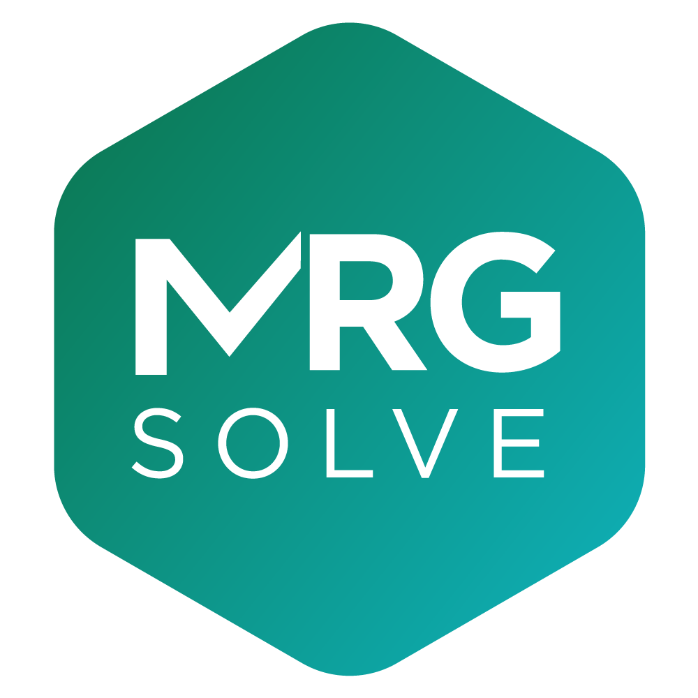

# Tools and Methods for Clinical Simulation

1. Introduction  - about mrgsolve
1. Three (or 4) simulation workflows  
2. Model syntax I
3. Working with simulated output
4. Customizing outputs
5. Model syntax II
6. Validation
7. Replicate simulation
