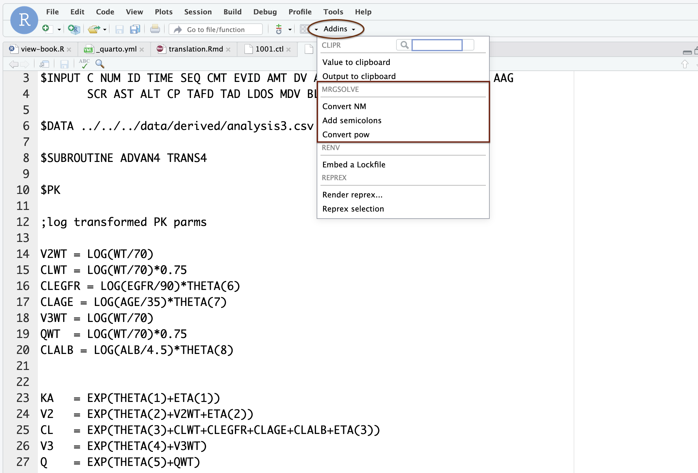

# Model specification 2 {#sec-specification-2}

```{r}
#| include: false
here::i_am(".here")
source(here::here("src/global.R"))
```


In this chapter, we'll keep going with model specification. This is the second
chapter on model specification. See @sec-specification-1 for the introductory
material.

## Covariate model

Like NONMEM, we can use `$PK` (or `$MAIN`) to code the covariate model, 
random effects, F, D, R, and ALAG, and initialize compartments. 

```{r}
#| eval: false
$PK

double CL = TVCL * (WT/70) ** 0.75 * exp(ETA(1));
```

- Any valid `c++` code is allowed
  - But we've added some sugar to make writing code easier
- Each line (statement) should end in semi-colon `;`


## C++ examples

```{c, eval=FALSE}
if(a == 2) b = 2;
if(b <= 2) {
  c=3;
} else {
  c=4;
}
d = a==2 ? 50 : 100;
double d = pow(base,exponent);
double e = exp(3);
double f = fabs(-4);
double g = sqrt(5);
double h = log(6);
double i = log10(7);
double j = floor(4.2);
double k = ceil(4.2);
```

::: {.callout-warning appearance="minimal"}
Be careful of integer division

```{r}
#| eval: false
double result = 1/2; # 0
```

Here, `result` will evaluate to `0`.
:::

Good practice to put `.0` behind whole numbers. 

```{r}
#| eval: false
double result = 1.0/2.0; # 0.5
```

::: {.callout-tip appearance="minimal"}
Starting with mrgsolve 2.0.0, you will be warned if you write integer division. 
Note: this could be what you want. See `?warn_int_div()` for details and an 
environment variable to use to turn this off. 
:::

Lots of help on the web
http://en.cppreference.com/w/cpp/numeric/math/tgamma


## Random effects

There are times when you _will_ need to code this manually. When estimating
with NONMEM and simulating with `mrgsolve`, these matrices will 
frequently be imported automatically via `$NMXML`.

### Omega / ETA

**Diagonal matrix**

```{r}
#| eval: false
$OMEGA
0.1 0.2 0.3
```

This is a 3x3 matrix with 0.1, 0.2, and 0.3 on the diagonal.

**Block matrix**

```{r}
#| eval: false
$OMEGA @block
0.1 0.002 0.3
```

This is a 2x2 matrix matrix with 0.1 and 0.3 on the diagonal. Sometimes it's 
easier to see when we code it like this

```{r}
#| eval: false
$OMEGA @block
0.1 
0.002 0.3
```

Random effects simulated from OMEGA are referred to with `ETA(n)`.

### Sigma / EPS

Works just like Omega / ETA, but use `$SIGMA` and `EPS(n)`.

For sigma-like theta, code it just as you would in NONMEM. 

```{r}
#| eval: false
$PARAM THETA12 = 0.025

$SIGMA 1

$ERROR
double W = sqrt(THETA12);
Y = (CENT/V) + W*EPS(1);
```

There is no `FIX` in `mrgsolve`; everything in OMEGA and SIGMA is always fixed.

::: {.callout-tip appearance="minimal"}
Starting with mrgsolve 2.0.0, you can write `ERR(n)` as an alias for `EPS(n)`.
:::

## Import estimates from NONMEM

- Use `$NMEXT` or `$NMXML`
  - `$NMEXT` reads from the `.ext` file
    - Can be faster
    - Doesn't retain `$OMEGA` and `$SIGMA` structure
  - `$NMXML` reads from the `.xml` file
    - Can be slower
    - Does retain `$OMEGA` and `$SIGMA` structure

This is the safest way to call

```{r}
#| eval: false
$NMXML
path = "../nonmem/106/106.xml"
```

You might be able to use this `run`/`project` approach as well

```{r}
#| eval: false
$NMXML 
run = 1006
project = "../sim/"
```

## Models in closed form

`mrgsolve` will solve one-, two-, and three-compartment models with first order
input in closed form. This usually results in substantial speed up. 
Use `$PKMODEL`. 

Starting with mrgsolve 2.0.0, you can pick the model with an `advan` number: 

```{r}
#| eval: false
$PKMODEL advan = 2
```

*  1 = One-compartment
*  2 = One-compartment, first order absorption
*  3 = Two-compartment
*  4 = Two-compartment, first order absorption
* 11 = Three-compartment
* 12 = Three-compartment, first order absorption

When you initialize with `advan` but don't name compartments, mrgsolve will 
set up compartments `A1`, `A2`, etc. 

Otherwise, pass the compartment names as `cmt`. 

```{r}
#| eval: false
$PKMODEL advan = 2, cmt = "DEPOT,CENTRAL"
```


Certain symbols are required to be defined depending on the model. `mrgsolve`
models are always parameterized in terms of clearances and volumes except
for absorption, which is in terms of rate constant. See `?PKMODEL` for details.

These can be defined as a parameter or a derived quantity in `$PK`.

Compartment names are user-choice; the only thing mrgsolve cares about is the 
number of compartments.

## Plugins

### autodec

Historically, you have had to _declare_ the type of any new variable you 
want to create. 

```{r}
#| eval: false
$PK
double KE = CL/V;
```

For most models, the numeric variables you declare are likely to be floating
point numbers ... with type `double`. 

We created a plugin that tells `mrgsolve` to look for new variables and 
declare them for you. 

```{r}
#| eval: false
$PLUGIN autodec

$PK
KE = CL/V;
```

### nm-vars

`mrgsolve` historically used

- `CENT`
- `dxdt_CENT`
- `F_CENT`
- `D_CENT`

etc. When we started `mrgsolve`, this was a really nice feature because you 
didn't have to think about compartment _numbers_. However, this made
translation of the model more difficult.

When you invoke the `nm-vars` plugin, you can write in a syntax that is much 
more like NONMEM.

For example

```{r}
#| eval: false
$PK
F2 = THETA(3);

ALAG2 = EXP(THETA(4));

$DES
DADT(1) = - KA * A(1);
```


Other convenience syntax 

- `LOG()` and `log()`
- `EXP()` and `exp()`
- `SQRT()` and `sqrt()`

Regardless of whether you have `nm-vars` invoked or not, you can still use
`THETA(n)` to refer to parameter `THETAn`.


Try the `nm-like` model in the model library for an example. 

```{r, eval = FALSE}
mod <- modlib("nm-like")

mod@code
```

## New features as of `mrgsolve` 2.0.0

### Use `base ** power` 

In C++, this calculation requires a function called `pow()`.

```{c eval = FALSE}
CL = THETA(1) * pow(WT/70, 0.75);
```

Starting with mrgsolve version 2.0.0, we can do this calculation using `**`

```{c eval = FALSE}
CL = THETA(1) * (WT / 70) ** 0.75; 
```

Notes:   

- No plugin required  
- mrgsolve does the conversion under the hood  
- See `?convert_pow` and "Convert pow" addin  


### Support for NONMEM/Fortran if/else/then

In mrgsolve and C++

```{r eval = FALSE}
if (SEX == 1) {
  CL = CL * THETA(10);
}
```

When you use the `nm-vars` plugin, you can keep the code you wrote in the 
NONMEM control stream.

```{c, eval = FALSE}
$PLUGIN nm-vars

$PK

...

IF(SEX.EQ.1) THEN 
  CL = CL * THETA(10);
ENDIF
```

Notes:   

- IF  
- IF/THEN  
- IF/THEN/ELSE  

### Semicolons!

Use the `semicolons` plugin to have mrgsolve add them for you

```{c, eval = FALSE}
$PLUGIN nm-vars semicolons

$PK
IF(SEX.EQ.1) THEN 
  CL = CL * THETA(10) // NOTE: no semicolon!
ENDIF
```

Use the `nm-like` plugin to invoke `autodec`, `nm-vars`, and `semicolons`.

::: {.callout-warning collapse=true appearance="simple"}
We recommend limiting the `semicolons` functionality to model code that is 
copied straight from a NONMEM control stream. When mrgsolve inspects the code
to determine where to put semicolons, it is expecting to see NONMEM-like code. 
The semicolons algorithm may fail when applying to native mrgsolve or other 
C++ code. 
:::


### ERR(n)

With the `nm-vars` plugin, mrgsolve now supports `ERR(n)` as an alias to 
`EPS(n)`.

## Addin

The Rstudio addin can be used to convert NONMEM code to native mrgsolve code. 




You don't _have_ to convert to code to native mrgsolve syntax. If you are 
running a tight cycle between NONMEM and mrgsolve, you can just leave it in 
the NONMEM format and let mrgsolve convert it on every model load. 

Once your model is finalized and you are modifying or extending for simulation, 
you may want to convert to mrgsolve native syntax for consistency within the 
model file.


### Rcpp (random numbers)

This gives you functions and data structures that you're used to using in R, 
but they work in `c++`. 

The main use for this is random number generation. Any d/q/p/r function 
in R will be available; arguments are the same, but omit `n` (you always 
get just one draw when calling from `c++`.

For a draw from U(0,1)

```{r}
#| eval: false
$PLUGIN Rcpp

$ERROR
double u = R::runif(0, 1);
```

Note: this will slightly increase compile time.

## Other blocks

- Use `$SETUP` to configure the model object on load
  - For example, set the simulation end time
- Use `$ENV` to define a set of R objects that might be evaluated in other 
  model blocks
- Use `$PRED` for other closed form models
- Use `$PREAMBLE` for code that gets run once at the start of a problem 
  `NEWIND==0`
- Use `$GLOBAL` to define variables outside of any other block

## Variables and macros

There is too much syntax to mention it all here. You will find all the 
syntax here

<https://mrgsolve.org/user-guide/specification.html#sec-variables-macros>


## Modeled event times

To get the model to stop at any time (even if not in the data set) with 
EVID 2

```{r}
#| eval: false
double mt1 = self.mtime(1.23 + ETA(1));
```

To get the model to stop at any time with user-specified EVID (e.g. 33)

```{r}
#| eval: false
self.mevent(1.23 + ETA(1), 33);
```
