```{r}
#| echo: false

library(tidyverse)
library(mrgsolve)
library(gridExtra)
library(here)

theme_set(theme_bw())
options(warn = -1)

# Functions to make summary PK profiles 
summ_pk_plot <- function(df, .x=NTIME, .y=DV, .facet=DOSE, 
                     logy=TRUE, show_obs=FALSE){
  dat <- df %>% group_by({{.x}}, {{.facet}}) %>% 
    summarise(
      as_tibble_row(
        quantile({{.y}}, c(0.025, 0.500, 0.975),na.rm = TRUE),
        .name_repair= ~ c("lo", "mi", "hi")
      ), 
      .groups = "drop") 
  
  p <- dat %>% ggplot(aes(x={{.x}}))+
    geom_line(aes(y=mi))+
    geom_ribbon(aes(ymin=lo, ymax=hi), alpha=0.25)+
    facet_grid(vars({{.facet}}), labeller=label_both)+
    ylab("")
  
  if(show_obs) p <- p + geom_point(data=df, aes(x={{.x}}, y=DV))
  if(logy) p <- p + scale_y_log10()
  return(p)
}

# Functions to plot raw PK (conc-time) profiles
raw_pk_plot <- function(df, .x=NTIME, .y=DV, .group=ID, .facet=DOSE, 
                   logy=TRUE){
  p <- df %>% ggplot(aes(x={{.x}}, y={{.y}}, group={{.group}}))+
    geom_point()+geom_line(alpha=0.2)+
    facet_grid(rows=vars({{.facet}}), labeller=label_both)
  
  if(logy) p <- p + scale_y_log10()
  
  return(p)
}

# Functions to. ake VPC plots
vpcplot <- function(obs_df, sim_df, 
                    .x=NTIME, .yobs=DV, .ysim=Y, .facet=DOSE, 
                    .color=NULL, .xlab=NULL, .ylab=NULL, 
                    percentile=c(0.10, 0.50, 0.90), 
                    prob=c(0.10, 0.50, 0.90), 
                    logy=TRUE, show_obs=FALSE, bins=NULL, 
                    pcvpc=FALSE){
  
  
  # Assign ticks, calculate middles for plotting
  if (is.null(bins)) {
    ticks <- NULL
    mids  <- NULL
  } else {
    bins <- sort(unique(as.numeric(bins)))
    ticks <- cut(bins, breaks = bins)[-1]
    mids  <- (bins[-1] + bins[-length(bins)]) / 2 # Calculate midpoints for plotting
  }
  
  if (is.null(ticks)){
    obs_df <- obs_df %>% mutate(.bin = {{.x}},.x_plot = {{.x}})
    sim_df <- sim_df %>% mutate(.bin = {{.x}},.x_plot = {{.x}})
  }else{
    obs_df <- obs_df %>% mutate(
      .bin = cut({{.x}}, breaks = bins, include.lowest = TRUE, right = TRUE),
      .x_plot = mids[as.integer(.bin)])
    sim_df <- sim_df %>% mutate(
      .bin = cut({{.x}}, breaks = bins, include.lowest = TRUE, right = TRUE),
      .x_plot = mids[as.integer(.bin)])
  }
  
  # Summarise observed percentiles
   obs <- obs_df %>% group_by(.bin, .x_plot, {{.facet}}) %>% 
      summarise(
        as_tibble_row(
          quantile({{.yobs}}, percentile,na.rm = TRUE),
          .name_repair= ~ c("lo", "mi", "hi")
        ), 
        .groups = "drop")
  
  # Summarise simulated percentiles
  sim <- sim_df %>% group_by(.bin, .x_plot, {{.facet}}, IREP) %>% 
    summarise(
      as_tibble_row(
        quantile({{.ysim}}, percentile,na.rm = TRUE),
        .name_repair= ~ c("lo", "mi", "hi")
      ), 
      .groups = "drop") 
  
  # Prediction correction
  if(pcvpc){
    # stopifnot("PRED" %in% names(sim_df))
    
    obs <- obs_df %>% mutate(.yobs = {{.yobs}}/PRED) %>% 
      group_by(.bin, .x_plot, {{.facet}}) %>% 
      mutate(pred_bin = median(PRED)) %>% 
      mutate(.yobs = .yobs*pred_bin) %>% 
      summarise(
        as_tibble_row(
          quantile(.yobs, percentile,na.rm = TRUE),
          .name_repair= ~ c("lo", "mi", "hi")
        ), 
        .groups = "drop")
    
    sim <- sim_df %>% mutate(.ysim = {{.ysim}}/PRED) %>% 
      group_by(.bin, .x_plot, {{.facet}}, IREP) %>% 
      mutate(pred_bin = median(PRED)) %>% 
      mutate(.ysim = .ysim*pred_bin) %>% 
      summarise(
        as_tibble_row(
          quantile(.ysim, percentile,na.rm = TRUE),
          .name_repair= ~ c("lo", "mi", "hi")
        ), 
        .groups = "drop")
  }
  
  # Summarise prediction intervals of simulated percentiles
  sim <- sim %>% group_by(.bin, .x_plot, {{.facet}}) %>% 
    summarise(
      across(c("lo", "mi", "hi"),
             ~ list(setNames(
               quantile(.x, prob, na.rm = TRUE),
               c("lo", "mi", "hi")
             ))),
      .groups = "drop"
    ) %>%
    # widen each list-column (one per Y) into 3 numeric columns
    unnest_wider(c("lo", "mi", "hi"), names_sep = "_")
  
  p <- ggplot()+
    geom_line(data=obs, aes(x=.x_plot, y=lo), linetype=2)+
    geom_line(data=obs, aes(x=.x_plot, y=mi), linetype=1)+
    geom_line(data=obs, aes(x=.x_plot, y=hi), linetype=2)+
    geom_ribbon(data=sim, aes(x=.x_plot, ymin=lo_lo, ymax=lo_hi), alpha=0.25, fill="#ffcc33")+
    geom_ribbon(data=sim, aes(x=.x_plot, ymin=mi_lo, ymax=mi_hi), alpha=0.25, fill="#7A0019")+
    geom_ribbon(data=sim, aes(x=.x_plot, ymin=hi_lo, ymax=hi_hi), alpha=0.25, fill="#ffcc33")+
    facet_grid(vars({{.facet}}), labeller=label_both)
  
  if(!is.null(xlab)) p <- p+xlab(.xlab)
  if(!is.null(ylab)) p <- p+ylab(.ylab)
  
  if(show_obs) p <- p + geom_point(data=obs_df, aes(x={{.x}}, y={{.yobs}}, color={{.color}}))
  
  if(pcvpc&show_obs){
    obs_df2 <- obs_df %>% mutate(.yobs = {{.yobs}}/PRED) %>% 
      group_by(.bin, .x_plot, {{.facet}}) %>% 
      mutate(pred_bin = median(PRED)) %>% 
      mutate(.yobs = .yobs*pred_bin) 
    p <- p + geom_point(data=obs_df2, aes(x={{.x}}, y=.yobs, color={{.color}}))
  }
  
  if(!is.null(bins)) p <- p + scale_x_continuous(
    limits = range(bins),
    expand = expansion(mult = c(0, 0.02)),
    sec.axis = dup_axis(
      name   = NULL,
      breaks = bins,           # tick positions on top
      labels = rep("", length(bins))  # no labels, ticks only
    )) + theme(
      axis.ticks.x.top  = element_line(),
      axis.ticks.length.x.top = unit(5, "pt")
    )
  
  if(logy) p <- p + scale_y_log10()
  
  return(p)
}

```

# Drug X {.smaller}

-   Drug X is a small molecule drug under early-phase clinical investigation to treat Disease Y in pediatric patients (age 2-18 years).

-   An phase-I single ascending dose (SAD) clinical study has been completed to investigate the PK of drug X, with 50 patients receiving 1, 2, 5, 10 and 20 mg dose of drug X.

-   A population PK model was developed using these PK data (`./wk10/model/hwwk6.mod`).

-   Some efficacy related endpoints were also collected and the clinical team are interested in exploring exposure-response relationships.

# Exercise 1: Stochastic Simulation {.smaller}

-   The study team is now designing a Phase 2 proof of concept (POC) study, which they plan to use a twice daily dose (BID) dosing. They want to understand what dosage levels are appropriate to test.

-   Preclinical study shows:

    -   IC90 of drug X is **1 ug/L**.
    -   Drug X concentration above **15 ug/L** is associated with dose-limit toxicity.

## Exercise 1: Question {.smaller}

<!-- The study team wants to maintain the steady-state Cmin above drug X IC90 (1 ug/L) in \> 80% patients while maintaining the steady-state Cmax below toxicity limit (15 ug/L) in \< 10% of patients. -->

Considering steady-state is achieved after 4 days with BID dosing. The study team is wondering:

-   At what dose levels can we achieve a steady-state Cmin \> 1 ug/L in \> 80% patients.

-   At what dose levels can we maintain a steady-state Cmax \> 15 ug/L in \< 10% patients.

## Workflow-Stochastic Simulations

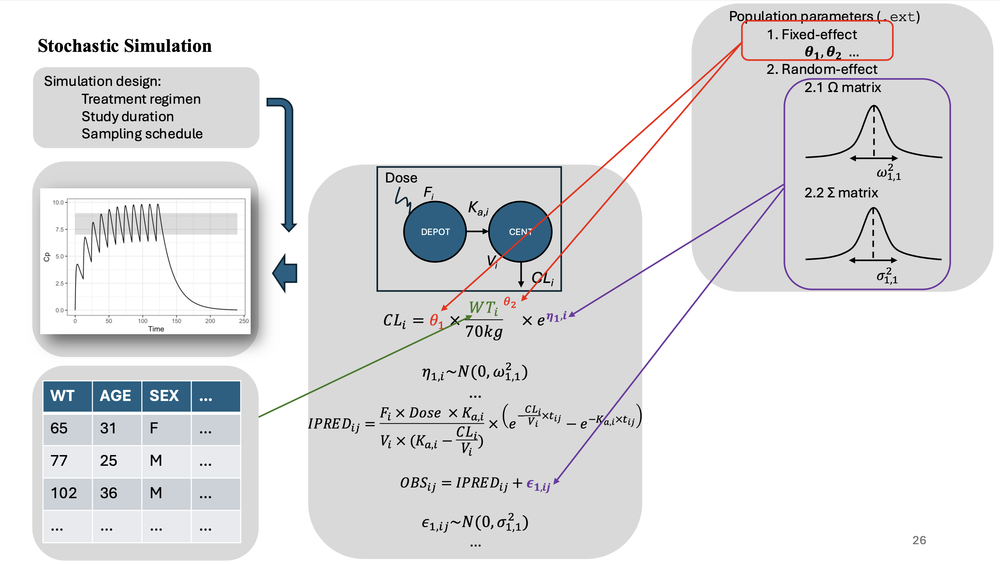

## Workflow-Stochastic Simulations

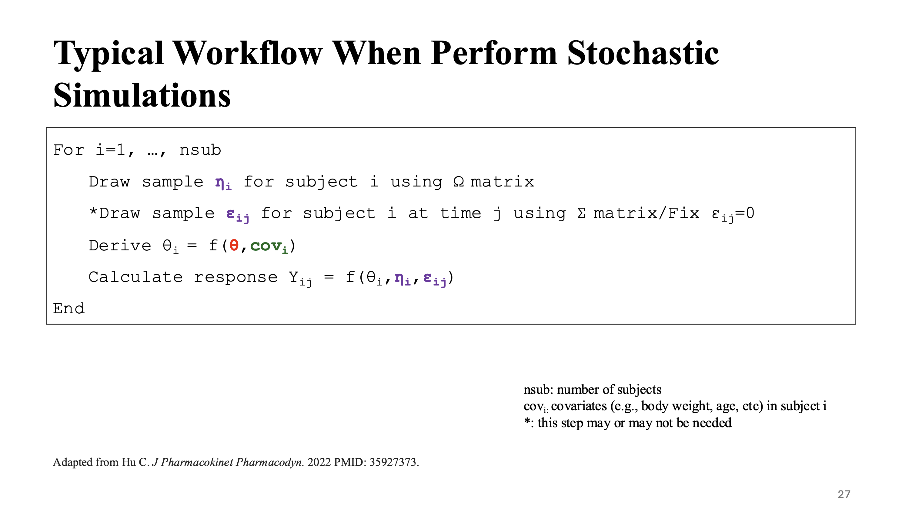

## Hands-on Session: Exercise 1 {.smaller}

**Files:**

-   `wk10/model/hwwk6.mod`: `mrgsolve` model for Drug X.
-   `wk10/ex1.R`: `R` script to implement simulation.
-   `wk10/data/pop.csv`: population covariate for simulation.

**Implementation notes:**

-   Don't need residual variability in simulation (`mod <- mod %>% zero_re(sigma)`).\
-   Use `wk10/data/pop.csv` for population covariates.\
-   Use `addl` and `ii` to implement multiple dosing (e.g., BID).
-   Weight-based dosing.
-   Need to have `rate=-2` to enable the use of dosing duration (`D1`) in the model.

## Hands-on Session: Exercise 1

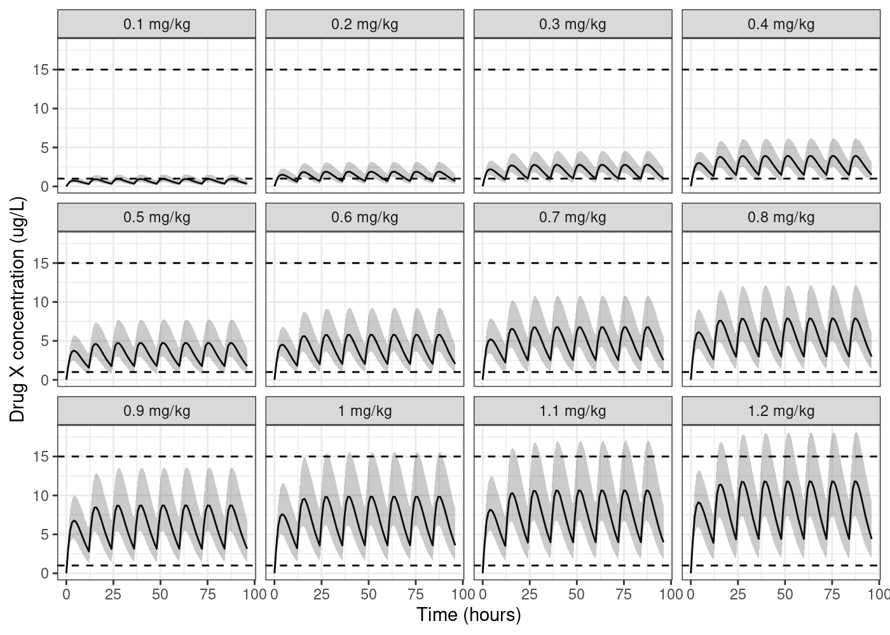

## Hands-on Session: Exercise 1 Cmin

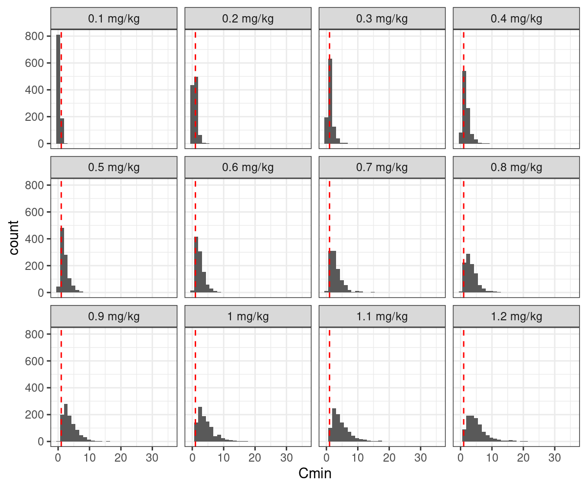

## Hands-on Session: Exercise 1 Cmin

::::: columns
::: {.column width="35%"}
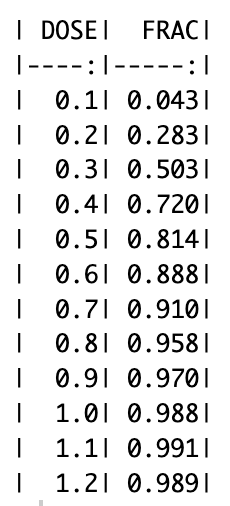
:::

::: {.column width="65%"}
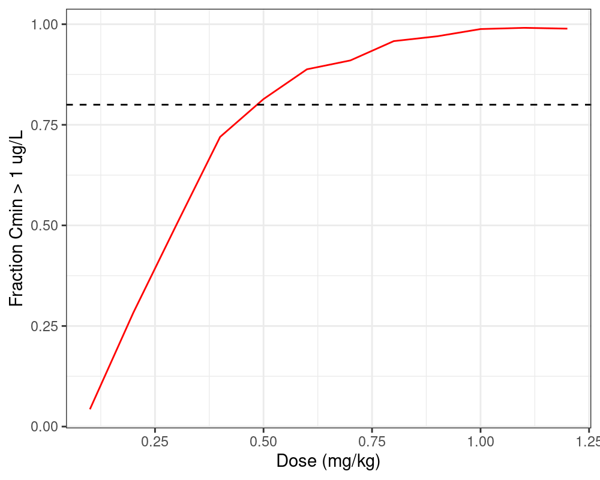
:::
:::::

## Hands-on Session: Exercise 1 Cmax

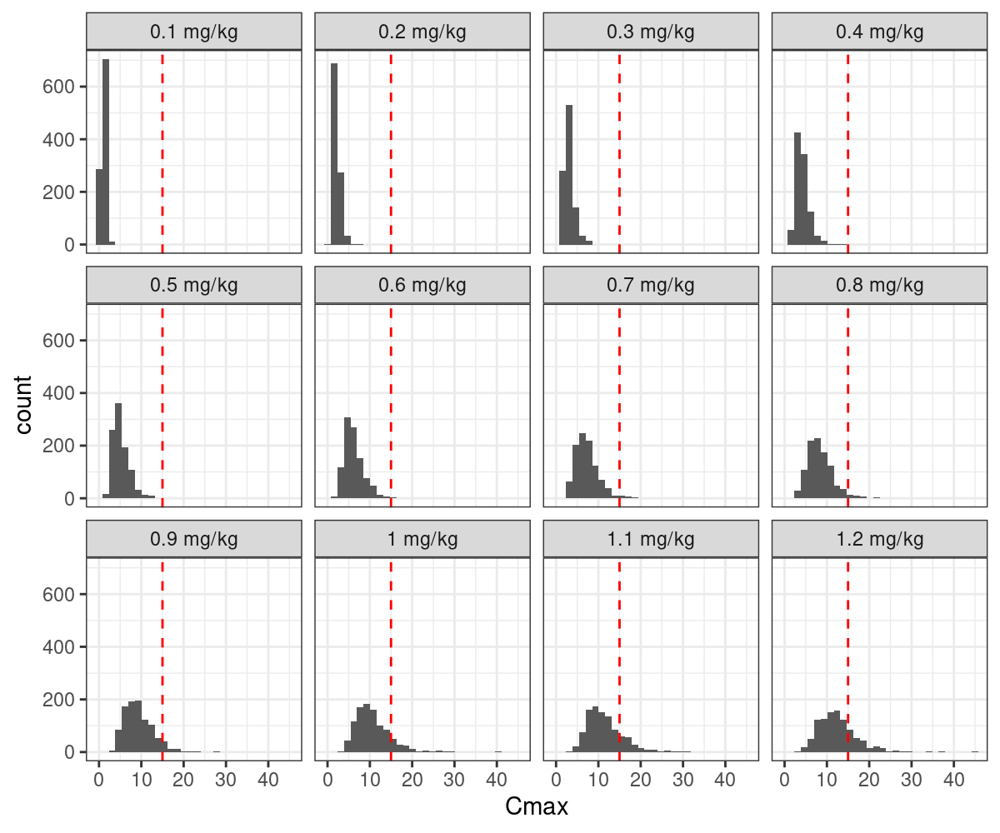

## Hands-on Session: Exercise 1 Cmax

::::: columns
::: {.column width="35%"}
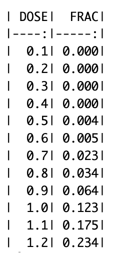
:::

::: {.column width="65%"}
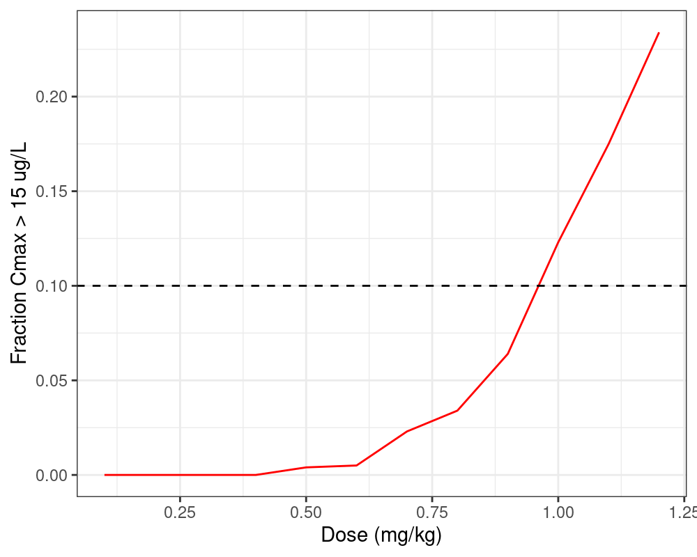
:::
:::::

# Visual Predictive Checks (VPCs) {.smaller}

-   Simulation-based diagnosis.
-   Standard model diagnostics use residuals and other comparisons between observed and predicted values.
-   Simulation-based diagnostics simulate from the model, and compare simulated data to observed data.
    -   If a model is developed to adequately characterize the data, the model can produce which are similar to that used to fit (i.e., develop) it.

## Example model {.smaller}

```{r}
#| echo: true
#| code-fold: true
#| code-summary: "Show the code"

code <- '
  [ prob ]
    One-compartmental model + 0 and 1st order abs and 1st order elim
    Allometric scaling on CL and V patrameters
    Covariate-effects (SEX, AGE, ALB) on CL
    Proportional error model
    This model requires mrgsolve >= 1.0.3
  
  [ cmt ] depot cent
  
  [ input ] 
    WT  = 70
    SEX = 1
    AGE = 35
    ALB = 4.5
  
  [ theta ]
    1.5    //  1 CL (L/hr) - 3.5
    5.0    //  2 V  (L) - 60
    0.5    //  3 KA (1/hr) - 1.5
    0.8    //  4 D1 (/hr) - 1.5
    0.7    //  5 SEX~CL (fractional multiplier)
    0.5    //  6 AGE~CL (exponent)
    0.2    //  7 ALB~CL (exponent)
    0.75   //  8 WT~CL (exponent)
    1.0    //  9 WT~CL (exponent)
  
  [ omega ] @correlation
    0.15             // ETA(CL)
    0.50 0.15        // ETA(V)
    0.10 0.20 0.1    // ETA(D1)
  
  [ sigma ]
    0.15              // Prop
  
    [ pk ]
    // Typical values of PK parameters
    double TVCL   = THETA(1);
    double TVV    = THETA(2);
    double TVKA   = THETA(3);
    double TVD1   = THETA(4);
    
    // PK covariates
    double CL_SEX = pow(THETA(5)  , SEX-1   );
    double CL_AGE = pow((AGE/35.0), THETA(6));
    double CL_ALB = pow((ALB/4.5) , THETA(7));
    double CL_WT  = pow((WT/70)   , THETA(8));
    double V_WT   = pow((WT/70)   , THETA(9));
    
    double CLCOV = CL_AGE*CL_WT;
    double VCOV  = V_WT;
    
    // PK parameters
    double CL = TVCL*CLCOV*exp(ETA(1));
    double V  = TVV*VCOV*exp(ETA(2)); 
    double KA = TVKA; 
    double D1 = TVD1*exp(ETA(3));
    
    double S2 = V;
    
    D_depot = D1; 
  
  [ ode ]
    dxdt_depot = -KA*depot;
    dxdt_cent = KA*depot - (CL/V)*cent; 
  
  [ error ] 
    double IPRED = cent/S2;
    double Y = IPRED * (1+EPS(1));
  
  [ capture ] CL V IPRED Y
  '

# Load model
mod <- mcode("example", code)
```

```{r}
#| echo: true
see(mod)
```

## Example data {.smaller}

```{r}
#| echo: false
#| code-fold: true
#| code-summary: "Show the code"

data <- structure(list(C = c(".", ".", ".", ".", ".", ".", ".", ".", 
".", ".", ".", ".", ".", ".", ".", ".", ".", ".", ".", ".", ".", 
".", ".", ".", ".", ".", ".", ".", ".", ".", ".", ".", ".", ".", 
".", ".", ".", ".", ".", ".", ".", ".", ".", ".", ".", ".", ".", 
".", ".", ".", ".", ".", ".", ".", ".", ".", ".", ".", ".", ".", 
".", ".", ".", ".", ".", ".", ".", ".", ".", ".", ".", ".", ".", 
".", ".", ".", ".", ".", ".", ".", ".", ".", ".", ".", ".", ".", 
".", ".", ".", ".", ".", ".", ".", ".", ".", ".", ".", ".", ".", 
".", ".", ".", ".", ".", ".", ".", ".", ".", ".", ".", ".", ".", 
".", ".", ".", ".", ".", ".", ".", ".", ".", ".", ".", ".", ".", 
".", ".", ".", ".", ".", ".", ".", ".", ".", ".", ".", ".", ".", 
".", ".", ".", ".", ".", ".", ".", ".", ".", ".", ".", ".", ".", 
".", ".", ".", ".", ".", ".", ".", ".", ".", ".", ".", ".", ".", 
".", ".", ".", ".", ".", ".", ".", ".", ".", ".", ".", ".", ".", 
".", ".", ".", ".", ".", ".", ".", ".", ".", ".", ".", ".", ".", 
".", ".", ".", ".", ".", ".", ".", ".", ".", ".", ".", ".", ".", 
".", ".", ".", ".", ".", ".", ".", ".", ".", ".", ".", ".", ".", 
".", ".", ".", ".", ".", ".", ".", ".", ".", ".", ".", ".", ".", 
".", ".", ".", ".", ".", ".", ".", ".", ".", ".", ".", ".", ".", 
".", ".", ".", ".", ".", ".", ".", ".", ".", ".", ".", ".", ".", 
".", ".", ".", ".", ".", ".", ".", ".", ".", ".", ".", ".", ".", 
".", ".", ".", ".", ".", ".", ".", ".", ".", ".", ".", ".", ".", 
".", ".", ".", ".", ".", ".", ".", ".", ".", ".", ".", ".", ".", 
".", ".", ".", ".", ".", ".", ".", ".", ".", ".", ".", ".", ".", 
".", ".", ".", ".", ".", ".", ".", ".", ".", ".", ".", ".", ".", 
".", ".", ".", ".", ".", ".", ".", ".", ".", ".", ".", ".", ".", 
".", ".", ".", ".", ".", ".", ".", ".", ".", ".", ".", ".", ".", 
".", ".", ".", ".", ".", ".", ".", ".", ".", ".", ".", ".", ".", 
".", ".", ".", ".", ".", ".", ".", ".", ".", ".", ".", ".", ".", 
".", ".", ".", ".", ".", ".", ".", ".", ".", ".", ".", ".", ".", 
".", ".", ".", ".", ".", ".", ".", ".", ".", ".", ".", ".", ".", 
".", ".", ".", ".", ".", ".", ".", ".", ".", ".", ".", ".", ".", 
".", ".", ".", ".", ".", ".", ".", ".", ".", ".", ".", ".", ".", 
".", ".", ".", ".", ".", ".", ".", ".", ".", ".", ".", ".", ".", 
".", ".", ".", ".", ".", ".", ".", ".", ".", ".", ".", ".", ".", 
".", ".", ".", ".", ".", ".", ".", ".", ".", ".", ".", ".", ".", 
".", ".", ".", ".", ".", ".", ".", ".", ".", ".", ".", ".", ".", 
".", ".", ".", ".", ".", ".", ".", ".", ".", ".", ".", ".", ".", 
".", ".", ".", ".", ".", ".", ".", ".", ".", ".", ".", ".", ".", 
".", ".", ".", ".", ".", ".", ".", ".", ".", ".", ".", ".", ".", 
".", ".", ".", ".", ".", ".", ".", ".", ".", ".", ".", ".", ".", 
".", ".", ".", ".", ".", ".", ".", ".", ".", ".", ".", ".", ".", 
".", ".", ".", ".", ".", ".", ".", ".", ".", ".", ".", ".", ".", 
".", ".", ".", ".", ".", ".", ".", ".", ".", ".", ".", ".", ".", 
".", ".", ".", ".", ".", ".", ".", ".", ".", ".", ".", ".", ".", 
".", ".", ".", ".", ".", ".", ".", ".", ".", ".", ".", ".", ".", 
".", ".", ".", ".", ".", ".", ".", ".", ".", ".", ".", ".", ".", 
".", ".", ".", ".", ".", ".", ".", ".", ".", ".", ".", ".", ".", 
".", ".", ".", ".", ".", ".", ".", ".", ".", ".", ".", ".", ".", 
".", ".", ".", ".", ".", ".", ".", ".", ".", ".", ".", ".", ".", 
".", ".", ".", ".", ".", "."), NUM = 1:651, ID = c(51L, 51L, 
51L, 51L, 51L, 51L, 52L, 52L, 52L, 52L, 52L, 52L, 53L, 53L, 53L, 
53L, 53L, 53L, 53L, 54L, 54L, 54L, 54L, 54L, 55L, 55L, 55L, 55L, 
55L, 55L, 56L, 56L, 56L, 56L, 56L, 56L, 56L, 57L, 57L, 57L, 57L, 
57L, 57L, 58L, 58L, 58L, 58L, 58L, 58L, 59L, 59L, 59L, 59L, 59L, 
59L, 60L, 60L, 60L, 60L, 60L, 60L, 61L, 61L, 61L, 61L, 61L, 62L, 
62L, 62L, 62L, 62L, 62L, 62L, 63L, 63L, 63L, 63L, 63L, 63L, 64L, 
64L, 64L, 64L, 64L, 64L, 64L, 65L, 65L, 65L, 65L, 65L, 65L, 66L, 
66L, 66L, 66L, 66L, 66L, 67L, 67L, 67L, 67L, 67L, 67L, 68L, 68L, 
68L, 68L, 68L, 69L, 69L, 69L, 69L, 69L, 70L, 70L, 70L, 70L, 70L, 
70L, 71L, 71L, 71L, 71L, 71L, 72L, 72L, 72L, 72L, 72L, 72L, 72L, 
73L, 73L, 73L, 73L, 73L, 74L, 74L, 74L, 74L, 74L, 75L, 75L, 75L, 
75L, 75L, 75L, 76L, 76L, 76L, 76L, 76L, 77L, 77L, 77L, 77L, 77L, 
77L, 77L, 78L, 78L, 78L, 78L, 78L, 78L, 79L, 79L, 79L, 79L, 79L, 
80L, 80L, 80L, 80L, 80L, 80L, 80L, 81L, 81L, 81L, 81L, 81L, 82L, 
82L, 82L, 82L, 82L, 83L, 83L, 83L, 83L, 83L, 83L, 83L, 84L, 84L, 
84L, 84L, 84L, 85L, 85L, 85L, 85L, 85L, 86L, 86L, 86L, 86L, 86L, 
86L, 86L, 87L, 87L, 87L, 87L, 87L, 88L, 88L, 88L, 88L, 88L, 88L, 
89L, 89L, 89L, 89L, 89L, 89L, 90L, 90L, 90L, 90L, 90L, 90L, 91L, 
91L, 91L, 91L, 91L, 91L, 91L, 92L, 92L, 92L, 92L, 92L, 92L, 92L, 
93L, 93L, 93L, 93L, 93L, 93L, 93L, 94L, 94L, 94L, 94L, 94L, 94L, 
95L, 95L, 95L, 95L, 95L, 95L, 95L, 96L, 96L, 96L, 96L, 96L, 96L, 
97L, 97L, 97L, 97L, 97L, 97L, 98L, 98L, 98L, 98L, 98L, 98L, 98L, 
99L, 99L, 99L, 99L, 99L, 99L, 99L, 100L, 100L, 100L, 100L, 100L, 
100L, 100L, 101L, 101L, 101L, 102L, 102L, 103L, 103L, 103L, 103L, 
104L, 104L, 104L, 104L, 105L, 105L, 105L, 105L, 106L, 106L, 106L, 
107L, 107L, 107L, 108L, 108L, 108L, 108L, 109L, 109L, 109L, 109L, 
110L, 110L, 110L, 110L, 111L, 111L, 111L, 112L, 112L, 112L, 112L, 
113L, 113L, 113L, 113L, 114L, 114L, 114L, 114L, 115L, 115L, 115L, 
116L, 116L, 116L, 116L, 117L, 117L, 117L, 117L, 118L, 118L, 118L, 
118L, 119L, 119L, 119L, 119L, 120L, 120L, 120L, 120L, 121L, 121L, 
121L, 121L, 122L, 122L, 122L, 123L, 123L, 123L, 123L, 124L, 124L, 
124L, 124L, 125L, 125L, 125L, 125L, 126L, 126L, 126L, 126L, 127L, 
127L, 127L, 128L, 128L, 128L, 129L, 129L, 129L, 129L, 130L, 130L, 
130L, 131L, 131L, 131L, 132L, 132L, 132L, 132L, 133L, 133L, 133L, 
134L, 134L, 134L, 134L, 135L, 135L, 135L, 135L, 136L, 136L, 136L, 
136L, 137L, 137L, 137L, 137L, 138L, 138L, 138L, 138L, 139L, 139L, 
139L, 139L, 140L, 140L, 140L, 141L, 141L, 141L, 142L, 142L, 142L, 
143L, 143L, 143L, 143L, 144L, 144L, 144L, 144L, 145L, 145L, 145L, 
146L, 146L, 146L, 146L, 147L, 147L, 147L, 148L, 148L, 148L, 149L, 
149L, 149L, 149L, 150L, 150L, 150L, 150L, 151L, 151L, 151L, 152L, 
152L, 152L, 152L, 153L, 153L, 153L, 153L, 154L, 154L, 154L, 155L, 
155L, 155L, 155L, 156L, 156L, 156L, 156L, 157L, 157L, 157L, 158L, 
158L, 159L, 159L, 159L, 159L, 160L, 161L, 161L, 161L, 162L, 162L, 
162L, 162L, 163L, 163L, 163L, 164L, 164L, 165L, 165L, 165L, 166L, 
166L, 166L, 166L, 167L, 167L, 168L, 168L, 168L, 168L, 169L, 169L, 
169L, 170L, 170L, 170L, 170L, 171L, 171L, 171L, 172L, 172L, 173L, 
173L, 173L, 173L, 174L, 174L, 174L, 174L, 175L, 175L, 175L, 175L, 
176L, 176L, 176L, 177L, 177L, 177L, 178L, 178L, 178L, 178L, 179L, 
179L, 179L, 179L, 180L, 180L, 180L, 180L, 181L, 181L, 181L, 182L, 
182L, 182L, 182L, 183L, 183L, 183L, 183L, 184L, 184L, 184L, 184L, 
185L, 185L, 186L, 186L, 186L, 187L, 187L, 188L, 188L, 188L, 188L, 
189L, 189L, 189L, 189L, 190L, 190L, 190L, 191L, 191L, 191L, 192L, 
192L, 192L, 192L, 193L, 193L, 193L, 193L, 194L, 194L, 194L, 194L, 
195L, 195L, 195L, 196L, 196L, 196L, 196L, 197L, 197L, 197L, 198L, 
198L, 198L, 198L, 199L, 199L, 199L, 200L, 200L, 200L, 200L), 
    TIME = c(0, 120.09, 121.04, 124.07, 128.24, 139.22, 0, 120.1, 
    120.23, 120.96, 127.76, 140.79, 0, 120.09, 120.23, 121.08, 
    124.11, 128.01, 138.3, 0, 120.09, 120.98, 124.22, 140.45, 
    0, 120.1, 120.24, 121.1, 124.09, 138.02, 0, 120.09, 120.26, 
    121, 124.26, 128.06, 140.52, 0, 120.11, 120.25, 120.93, 123.94, 
    127.64, 0, 120.1, 120.25, 124.05, 128.11, 138.18, 0, 120.09, 
    120.23, 123.74, 128.29, 141.57, 0, 120.09, 120.26, 121.01, 
    123.68, 127.55, 0, 120.09, 120.26, 128.14, 138.9, 0, 120.11, 
    120.23, 121.07, 123.82, 128.41, 139.92, 0, 120.1, 120.24, 
    124.37, 128.46, 138.33, 0, 120.1, 120.27, 120.94, 124.04, 
    127.7, 140.66, 0, 120.1, 121.06, 123.65, 127.52, 139.82, 
    0, 120.09, 120.24, 123.99, 128.48, 139.13, 0, 120.1, 120.27, 
    121.09, 123.88, 138.5, 0, 120.1, 120.99, 123.84, 127.32, 
    0, 120.09, 121.09, 128.53, 139.57, 0, 120.1, 120.24, 121.02, 
    128.75, 141.85, 0, 120.1, 120.23, 123.89, 128.06, 0, 120.09, 
    120.24, 121, 124.08, 128.43, 140.56, 0, 120.26, 124.29, 128.6, 
    139.6, 0, 120.09, 120.23, 120.96, 123.67, 0, 120.1, 120.25, 
    124.24, 127.46, 139.65, 0, 120.11, 121.01, 123.74, 141.26, 
    0, 120.09, 120.23, 120.97, 123.75, 128.49, 139.87, 0, 120.09, 
    120.25, 123.78, 127.83, 140.4, 0, 120.11, 120.97, 128.25, 
    138.1, 0, 120.1, 120.24, 120.91, 123.96, 127.82, 138.24, 
    0, 120.25, 121.1, 128.27, 141.92, 0, 120.11, 120.26, 121.07, 
    127.45, 0, 120.1, 120.25, 121.09, 123.75, 128.24, 139.52, 
    0, 120.11, 120.91, 128.08, 140.79, 0, 120.1, 120.26, 121.09, 
    124.22, 0, 120.09, 120.23, 121.01, 123.7, 127.61, 138.07, 
    0, 120.27, 121.08, 127.67, 140.02, 0, 120.09, 120.24, 121.08, 
    123.84, 141.29, 0, 120.1, 120.23, 120.99, 128.65, 140.68, 
    0, 120.1, 120.23, 121.09, 124.02, 138.3, 0, 120.1, 120.23, 
    120.93, 124.02, 127.45, 141.36, 0, 120.11, 120.26, 121.05, 
    124.31, 127.98, 141.96, 0, 120.11, 120.26, 120.91, 123.89, 
    127.82, 140.5, 0, 120.23, 121.1, 124.12, 127.8, 141.43, 0, 
    120.11, 120.24, 121.07, 123.77, 128.66, 141.52, 0, 120.25, 
    120.92, 124.02, 127.45, 138.83, 0, 120.1, 120.27, 120.92, 
    124.37, 138.8, 0, 120.11, 120.24, 121.03, 123.95, 128.15, 
    140.21, 0, 120.1, 120.24, 121.07, 124.09, 128.19, 141.91, 
    0, 120.1, 120.23, 121.05, 124.36, 127.84, 141.04, 0, 124.2, 
    141.7, 0, 121, 0, 121, 123.9, 139.41, 0, 120.93, 124.31, 
    138.11, 0, 121.08, 123.98, 141.41, 0, 121.09, 124.29, 0, 
    121.02, 139.94, 0, 121.04, 123.77, 139.04, 0, 121, 124.22, 
    141.01, 0, 120.99, 124.28, 140.16, 0, 124.15, 140.94, 0, 
    121.02, 124.29, 139.83, 0, 121.04, 123.75, 141.8, 0, 120.94, 
    124.3, 141.93, 0, 120.92, 124.07, 0, 120.98, 123.95, 141.4, 
    0, 121.02, 123.98, 141.38, 0, 121, 124.24, 138.44, 0, 121.05, 
    124.39, 141.45, 0, 121.09, 124.3, 141.78, 0, 120.92, 124.07, 
    139.09, 0, 123.68, 140, 0, 120.95, 123.85, 141.17, 0, 120.93, 
    124.34, 140.93, 0, 120.9, 124.32, 138.21, 0, 120.97, 123.64, 
    138.17, 0, 121.02, 124.27, 0, 121.04, 139.1, 0, 121.09, 123.88, 
    141.05, 0, 121.08, 123.75, 0, 121, 123.7, 0, 121.03, 124.26, 
    139.4, 0, 124.22, 141.48, 0, 120.98, 123.67, 141.42, 0, 121.01, 
    123.77, 138.41, 0, 121.03, 124.18, 139.27, 0, 120.91, 124.39, 
    140.33, 0, 121.04, 123.99, 138.71, 0, 121.1, 124.06, 138.6, 
    0, 123.61, 141.52, 0, 120.94, 124.37, 0, 120.98, 124.11, 
    0, 120.94, 124.23, 141.72, 0, 121.1, 124.38, 140.72, 0, 123.68, 
    139.71, 0, 121, 124.04, 140.57, 0, 120.96, 139.93, 0, 124.34, 
    138.53, 0, 120.94, 123.98, 139.86, 0, 121.04, 124.06, 139.6, 
    0, 121.05, 140.17, 0, 121.06, 124.18, 141.19, 0, 120.96, 
    123.65, 140.24, 0, 124.34, 140.34, 0, 120.98, 124.21, 140.87, 
    0, 121.03, 123.8, 139.03, 0, 124.1, 139.24, 0, 138.37, 0, 
    121.06, 123.89, 141.52, 0, 0, 124.14, 139.94, 0, 120.95, 
    124.22, 140.85, 0, 121.04, 123.86, 0, 123.93, 0, 120.91, 
    124.17, 0, 120.91, 123.98, 141.35, 0, 140.09, 0, 121.06, 
    124.21, 141.15, 0, 124.14, 139.03, 0, 120.96, 124.19, 139.74, 
    0, 120.95, 123.69, 0, 120.98, 0, 121.01, 124.2, 140.82, 0, 
    121.02, 123.82, 141.01, 0, 121.09, 124.17, 141.18, 0, 121.07, 
    124.01, 0, 121.03, 124.1, 0, 120.99, 124.3, 141.68, 0, 120.95, 
    124.27, 140.66, 0, 120.92, 123.81, 140.33, 0, 120.99, 124.22, 
    0, 120.91, 124.35, 138.15, 0, 120.93, 124.07, 141.39, 0, 
    121.05, 124.28, 139.89, 0, 139.48, 0, 123.78, 139.84, 0, 
    140.48, 0, 121.08, 124.34, 140.09, 0, 121.07, 123.83, 138.28, 
    0, 124.3, 140.92, 0, 120.96, 123.93, 0, 120.98, 123.78, 140.78, 
    0, 121.03, 124.38, 138.67, 0, 120.97, 123.96, 141.15, 0, 
    121, 123.8, 0, 121.03, 124.34, 140.29, 0, 121.08, 123.81, 
    0, 121.07, 124.06, 139.77, 0, 123.99, 138.46, 0, 121.05, 
    124.1, 139.26), NTIME = c(120.1, 120.1, 121, 124, 128, 140, 
    120.1, 120.1, 120.25, 121, 128, 140, 120.1, 120.1, 120.25, 
    121, 124, 128, 140, 120.1, 120.1, 121, 124, 140, 120.1, 120.1, 
    120.25, 121, 124, 140, 120.1, 120.1, 120.25, 121, 124, 128, 
    140, 120.1, 120.1, 120.25, 121, 124, 128, 120.1, 120.1, 120.25, 
    124, 128, 140, 120.1, 120.1, 120.25, 124, 128, 140, 120.1, 
    120.1, 120.25, 121, 124, 128, 120.1, 120.1, 120.25, 128, 
    140, 120.1, 120.1, 120.25, 121, 124, 128, 140, 120.1, 120.1, 
    120.25, 124, 128, 140, 120.1, 120.1, 120.25, 121, 124, 128, 
    140, 120.1, 120.1, 121, 124, 128, 140, 120.1, 120.1, 120.25, 
    124, 128, 140, 120.1, 120.1, 120.25, 121, 124, 140, 120.1, 
    120.1, 121, 124, 128, 120.1, 120.1, 121, 128, 140, 120.1, 
    120.1, 120.25, 121, 128, 140, 120.1, 120.1, 120.25, 124, 
    128, 120.1, 120.1, 120.25, 121, 124, 128, 140, 120.1, 120.25, 
    124, 128, 140, 120.1, 120.1, 120.25, 121, 124, 120.1, 120.1, 
    120.25, 124, 128, 140, 120.1, 120.1, 121, 124, 140, 120.1, 
    120.1, 120.25, 121, 124, 128, 140, 120.1, 120.1, 120.25, 
    124, 128, 140, 120.1, 120.1, 121, 128, 140, 120.1, 120.1, 
    120.25, 121, 124, 128, 140, 120.1, 120.25, 121, 128, 140, 
    120.1, 120.1, 120.25, 121, 128, 120.1, 120.1, 120.25, 121, 
    124, 128, 140, 120.1, 120.1, 121, 128, 140, 120.1, 120.1, 
    120.25, 121, 124, 120.1, 120.1, 120.25, 121, 124, 128, 140, 
    120.1, 120.25, 121, 128, 140, 120.1, 120.1, 120.25, 121, 
    124, 140, 120.1, 120.1, 120.25, 121, 128, 140, 120.1, 120.1, 
    120.25, 121, 124, 140, 120.1, 120.1, 120.25, 121, 124, 128, 
    140, 120.1, 120.1, 120.25, 121, 124, 128, 140, 120.1, 120.1, 
    120.25, 121, 124, 128, 140, 120.1, 120.25, 121, 124, 128, 
    140, 120.1, 120.1, 120.25, 121, 124, 128, 140, 120.1, 120.25, 
    121, 124, 128, 140, 120.1, 120.1, 120.25, 121, 124, 140, 
    120.1, 120.1, 120.25, 121, 124, 128, 140, 120.1, 120.1, 120.25, 
    121, 124, 128, 140, 120.1, 120.1, 120.25, 121, 124, 128, 
    140, 120.1, 124, 140, 120.1, 121, 120.1, 121, 124, 140, 120.1, 
    121, 124, 140, 120.1, 121, 124, 140, 120.1, 121, 124, 120.1, 
    121, 140, 120.1, 121, 124, 140, 120.1, 121, 124, 140, 120.1, 
    121, 124, 140, 120.1, 124, 140, 120.1, 121, 124, 140, 120.1, 
    121, 124, 140, 120.1, 121, 124, 140, 120.1, 121, 124, 120.1, 
    121, 124, 140, 120.1, 121, 124, 140, 120.1, 121, 124, 140, 
    120.1, 121, 124, 140, 120.1, 121, 124, 140, 120.1, 121, 124, 
    140, 120.1, 124, 140, 120.1, 121, 124, 140, 120.1, 121, 124, 
    140, 120.1, 121, 124, 140, 120.1, 121, 124, 140, 120.1, 121, 
    124, 120.1, 121, 140, 120.1, 121, 124, 140, 120.1, 121, 124, 
    120.1, 121, 124, 120.1, 121, 124, 140, 120.1, 124, 140, 120.1, 
    121, 124, 140, 120.1, 121, 124, 140, 120.1, 121, 124, 140, 
    120.1, 121, 124, 140, 120.1, 121, 124, 140, 120.1, 121, 124, 
    140, 120.1, 124, 140, 120.1, 121, 124, 120.1, 121, 124, 120.1, 
    121, 124, 140, 120.1, 121, 124, 140, 120.1, 124, 140, 120.1, 
    121, 124, 140, 120.1, 121, 140, 120.1, 124, 140, 120.1, 121, 
    124, 140, 120.1, 121, 124, 140, 120.1, 121, 140, 120.1, 121, 
    124, 140, 120.1, 121, 124, 140, 120.1, 124, 140, 120.1, 121, 
    124, 140, 120.1, 121, 124, 140, 120.1, 124, 140, 120.1, 140, 
    120.1, 121, 124, 140, 120.1, 120.1, 124, 140, 120.1, 121, 
    124, 140, 120.1, 121, 124, 120.1, 124, 120.1, 121, 124, 120.1, 
    121, 124, 140, 120.1, 140, 120.1, 121, 124, 140, 120.1, 124, 
    140, 120.1, 121, 124, 140, 120.1, 121, 124, 120.1, 121, 120.1, 
    121, 124, 140, 120.1, 121, 124, 140, 120.1, 121, 124, 140, 
    120.1, 121, 124, 120.1, 121, 124, 120.1, 121, 124, 140, 120.1, 
    121, 124, 140, 120.1, 121, 124, 140, 120.1, 121, 124, 120.1, 
    121, 124, 140, 120.1, 121, 124, 140, 120.1, 121, 124, 140, 
    120.1, 140, 120.1, 124, 140, 120.1, 140, 120.1, 121, 124, 
    140, 120.1, 121, 124, 140, 120.1, 124, 140, 120.1, 121, 124, 
    120.1, 121, 124, 140, 120.1, 121, 124, 140, 120.1, 121, 124, 
    140, 120.1, 121, 124, 120.1, 121, 124, 140, 120.1, 121, 124, 
    120.1, 121, 124, 140, 120.1, 124, 140, 120.1, 121, 124, 140
    ), TAD = c(0, 0.09, 1.04, 4.07, 8.24, 19.22, 0, 0.1, 0.23, 
    0.96, 7.76, 20.79, 0, 0.09, 0.23, 1.08, 4.11, 8.01, 18.3, 
    0, 0.09, 0.98, 4.22, 20.45, 0, 0.1, 0.24, 1.1, 4.09, 18.02, 
    0, 0.09, 0.26, 1, 4.26, 8.06, 20.52, 0, 0.11, 0.25, 0.93, 
    3.94, 7.64, 0, 0.1, 0.25, 4.05, 8.11, 18.18, 0, 0.09, 0.23, 
    3.74, 8.29, 21.57, 0, 0.09, 0.26, 1.01, 3.68, 7.55, 0, 0.09, 
    0.26, 8.14, 18.9, 0, 0.11, 0.23, 1.07, 3.82, 8.41, 19.92, 
    0, 0.1, 0.24, 4.37, 8.46, 18.33, 0, 0.1, 0.27, 0.94, 4.04, 
    7.7, 20.66, 0, 0.1, 1.06, 3.65, 7.52, 19.82, 0, 0.09, 0.24, 
    3.99, 8.48, 19.13, 0, 0.1, 0.27, 1.09, 3.88, 18.5, 0, 0.1, 
    0.99, 3.84, 7.32, 0, 0.09, 1.09, 8.53, 19.57, 0, 0.1, 0.24, 
    1.02, 8.75, 21.85, 0, 0.1, 0.23, 3.89, 8.06, 0, 0.09, 0.24, 
    1, 4.08, 8.43, 20.56, 0, 0.26, 4.29, 8.6, 19.6, 0, 0.09, 
    0.23, 0.96, 3.67, 0, 0.1, 0.25, 4.24, 7.46, 19.65, 0, 0.11, 
    1.01, 3.74, 21.26, 0, 0.09, 0.23, 0.97, 3.75, 8.49, 19.87, 
    0, 0.09, 0.25, 3.78, 7.83, 20.4, 0, 0.11, 0.97, 8.25, 18.1, 
    0, 0.1, 0.24, 0.91, 3.96, 7.82, 18.24, 0, 0.25, 1.1, 8.27, 
    21.92, 0, 0.11, 0.26, 1.07, 7.45, 0, 0.1, 0.25, 1.09, 3.75, 
    8.24, 19.52, 0, 0.11, 0.91, 8.08, 20.79, 0, 0.1, 0.26, 1.09, 
    4.22, 0, 0.09, 0.23, 1.01, 3.7, 7.61, 18.07, 0, 0.27, 1.08, 
    7.67, 20.02, 0, 0.09, 0.24, 1.08, 3.84, 21.29, 0, 0.1, 0.23, 
    0.99, 8.65, 20.68, 0, 0.1, 0.23, 1.09, 4.02, 18.3, 0, 0.1, 
    0.23, 0.93, 4.02, 7.45, 21.36, 0, 0.11, 0.26, 1.05, 4.31, 
    7.98, 21.96, 0, 0.11, 0.26, 0.91, 3.89, 7.82, 20.5, 0, 0.23, 
    1.1, 4.12, 7.8, 21.43, 0, 0.11, 0.24, 1.07, 3.77, 8.66, 21.52, 
    0, 0.25, 0.92, 4.02, 7.45, 18.83, 0, 0.1, 0.27, 0.92, 4.37, 
    18.8, 0, 0.11, 0.24, 1.03, 3.95, 8.15, 20.21, 0, 0.1, 0.24, 
    1.07, 4.09, 8.19, 21.91, 0, 0.1, 0.23, 1.05, 4.36, 7.84, 
    21.04, 0, 4.2, 21.7, 0, 1, 0, 1, 3.9, 19.41, 0, 0.93, 4.31, 
    18.11, 0, 1.08, 3.98, 21.41, 0, 1.09, 4.29, 0, 1.02, 19.94, 
    0, 1.04, 3.77, 19.04, 0, 1, 4.22, 21.01, 0, 0.99, 4.28, 20.16, 
    0, 4.15, 20.94, 0, 1.02, 4.29, 19.83, 0, 1.04, 3.75, 21.8, 
    0, 0.94, 4.3, 21.93, 0, 0.92, 4.07, 0, 0.98, 3.95, 21.4, 
    0, 1.02, 3.98, 21.38, 0, 1, 4.24, 18.44, 0, 1.05, 4.39, 21.45, 
    0, 1.09, 4.3, 21.78, 0, 0.92, 4.07, 19.09, 0, 3.68, 20, 0, 
    0.95, 3.85, 21.17, 0, 0.93, 4.34, 20.93, 0, 0.9, 4.32, 18.21, 
    0, 0.97, 3.64, 18.17, 0, 1.02, 4.27, 0, 1.04, 19.1, 0, 1.09, 
    3.88, 21.05, 0, 1.08, 3.75, 0, 1, 3.7, 0, 1.03, 4.26, 19.4, 
    0, 4.22, 21.48, 0, 0.98, 3.67, 21.42, 0, 1.01, 3.77, 18.41, 
    0, 1.03, 4.18, 19.27, 0, 0.91, 4.39, 20.33, 0, 1.04, 3.99, 
    18.71, 0, 1.1, 4.06, 18.6, 0, 3.61, 21.52, 0, 0.94, 4.37, 
    0, 0.98, 4.11, 0, 0.94, 4.23, 21.72, 0, 1.1, 4.38, 20.72, 
    0, 3.68, 19.71, 0, 1, 4.04, 20.57, 0, 0.96, 19.93, 0, 4.34, 
    18.53, 0, 0.94, 3.98, 19.86, 0, 1.04, 4.06, 19.6, 0, 1.05, 
    20.17, 0, 1.06, 4.18, 21.19, 0, 0.96, 3.65, 20.24, 0, 4.34, 
    20.34, 0, 0.98, 4.21, 20.87, 0, 1.03, 3.8, 19.03, 0, 4.1, 
    19.24, 0, 18.37, 0, 1.06, 3.89, 21.52, 0, 0, 4.14, 19.94, 
    0, 0.95, 4.22, 20.85, 0, 1.04, 3.86, 0, 3.93, 0, 0.91, 4.17, 
    0, 0.91, 3.98, 21.35, 0, 20.09, 0, 1.06, 4.21, 21.15, 0, 
    4.14, 19.03, 0, 0.96, 4.19, 19.74, 0, 0.95, 3.69, 0, 0.98, 
    0, 1.01, 4.2, 20.82, 0, 1.02, 3.82, 21.01, 0, 1.09, 4.17, 
    21.18, 0, 1.07, 4.01, 0, 1.03, 4.1, 0, 0.99, 4.3, 21.68, 
    0, 0.95, 4.27, 20.66, 0, 0.92, 3.81, 20.33, 0, 0.99, 4.22, 
    0, 0.91, 4.35, 18.15, 0, 0.93, 4.07, 21.39, 0, 1.05, 4.28, 
    19.89, 0, 19.48, 0, 3.78, 19.84, 0, 20.48, 0, 1.08, 4.34, 
    20.09, 0, 1.07, 3.83, 18.28, 0, 4.3, 20.92, 0, 0.96, 3.93, 
    0, 0.98, 3.78, 20.78, 0, 1.03, 4.38, 18.67, 0, 0.97, 3.96, 
    21.15, 0, 1, 3.8, 0, 1.03, 4.34, 20.29, 0, 1.08, 3.81, 0, 
    1.07, 4.06, 19.77, 0, 3.99, 18.46, 0, 1.05, 4.1, 19.26), 
    AMT = c(200L, 0L, 0L, 0L, 0L, 0L, 200L, 0L, 0L, 0L, 0L, 0L, 
    200L, 0L, 0L, 0L, 0L, 0L, 0L, 200L, 0L, 0L, 0L, 0L, 200L, 
    0L, 0L, 0L, 0L, 0L, 200L, 0L, 0L, 0L, 0L, 0L, 0L, 200L, 0L, 
    0L, 0L, 0L, 0L, 200L, 0L, 0L, 0L, 0L, 0L, 200L, 0L, 0L, 0L, 
    0L, 0L, 200L, 0L, 0L, 0L, 0L, 0L, 200L, 0L, 0L, 0L, 0L, 200L, 
    0L, 0L, 0L, 0L, 0L, 0L, 200L, 0L, 0L, 0L, 0L, 0L, 200L, 0L, 
    0L, 0L, 0L, 0L, 0L, 200L, 0L, 0L, 0L, 0L, 0L, 200L, 0L, 0L, 
    0L, 0L, 0L, 200L, 0L, 0L, 0L, 0L, 0L, 200L, 0L, 0L, 0L, 0L, 
    200L, 0L, 0L, 0L, 0L, 200L, 0L, 0L, 0L, 0L, 0L, 200L, 0L, 
    0L, 0L, 0L, 200L, 0L, 0L, 0L, 0L, 0L, 0L, 200L, 0L, 0L, 0L, 
    0L, 200L, 0L, 0L, 0L, 0L, 200L, 0L, 0L, 0L, 0L, 0L, 200L, 
    0L, 0L, 0L, 0L, 200L, 0L, 0L, 0L, 0L, 0L, 0L, 200L, 0L, 0L, 
    0L, 0L, 0L, 200L, 0L, 0L, 0L, 0L, 200L, 0L, 0L, 0L, 0L, 0L, 
    0L, 200L, 0L, 0L, 0L, 0L, 200L, 0L, 0L, 0L, 0L, 200L, 0L, 
    0L, 0L, 0L, 0L, 0L, 200L, 0L, 0L, 0L, 0L, 200L, 0L, 0L, 0L, 
    0L, 200L, 0L, 0L, 0L, 0L, 0L, 0L, 200L, 0L, 0L, 0L, 0L, 200L, 
    0L, 0L, 0L, 0L, 0L, 200L, 0L, 0L, 0L, 0L, 0L, 200L, 0L, 0L, 
    0L, 0L, 0L, 200L, 0L, 0L, 0L, 0L, 0L, 0L, 200L, 0L, 0L, 0L, 
    0L, 0L, 0L, 200L, 0L, 0L, 0L, 0L, 0L, 0L, 200L, 0L, 0L, 0L, 
    0L, 0L, 200L, 0L, 0L, 0L, 0L, 0L, 0L, 200L, 0L, 0L, 0L, 0L, 
    0L, 200L, 0L, 0L, 0L, 0L, 0L, 200L, 0L, 0L, 0L, 0L, 0L, 0L, 
    200L, 0L, 0L, 0L, 0L, 0L, 0L, 200L, 0L, 0L, 0L, 0L, 0L, 0L, 
    300L, 0L, 0L, 300L, 0L, 300L, 0L, 0L, 0L, 300L, 0L, 0L, 0L, 
    300L, 0L, 0L, 0L, 300L, 0L, 0L, 300L, 0L, 0L, 300L, 0L, 0L, 
    0L, 300L, 0L, 0L, 0L, 300L, 0L, 0L, 0L, 300L, 0L, 0L, 300L, 
    0L, 0L, 0L, 300L, 0L, 0L, 0L, 300L, 0L, 0L, 0L, 300L, 0L, 
    0L, 300L, 0L, 0L, 0L, 300L, 0L, 0L, 0L, 300L, 0L, 0L, 0L, 
    300L, 0L, 0L, 0L, 300L, 0L, 0L, 0L, 300L, 0L, 0L, 0L, 300L, 
    0L, 0L, 300L, 0L, 0L, 0L, 300L, 0L, 0L, 0L, 300L, 0L, 0L, 
    0L, 300L, 0L, 0L, 0L, 300L, 0L, 0L, 300L, 0L, 0L, 300L, 0L, 
    0L, 0L, 300L, 0L, 0L, 300L, 0L, 0L, 300L, 0L, 0L, 0L, 300L, 
    0L, 0L, 300L, 0L, 0L, 0L, 300L, 0L, 0L, 0L, 300L, 0L, 0L, 
    0L, 300L, 0L, 0L, 0L, 300L, 0L, 0L, 0L, 300L, 0L, 0L, 0L, 
    300L, 0L, 0L, 300L, 0L, 0L, 300L, 0L, 0L, 300L, 0L, 0L, 0L, 
    300L, 0L, 0L, 0L, 300L, 0L, 0L, 300L, 0L, 0L, 0L, 300L, 0L, 
    0L, 300L, 0L, 0L, 300L, 0L, 0L, 0L, 300L, 0L, 0L, 0L, 400L, 
    0L, 0L, 400L, 0L, 0L, 0L, 400L, 0L, 0L, 0L, 400L, 0L, 0L, 
    400L, 0L, 0L, 0L, 400L, 0L, 0L, 0L, 400L, 0L, 0L, 400L, 0L, 
    400L, 0L, 0L, 0L, 400L, 400L, 0L, 0L, 400L, 0L, 0L, 0L, 400L, 
    0L, 0L, 400L, 0L, 400L, 0L, 0L, 400L, 0L, 0L, 0L, 400L, 0L, 
    400L, 0L, 0L, 0L, 400L, 0L, 0L, 400L, 0L, 0L, 0L, 400L, 0L, 
    0L, 400L, 0L, 400L, 0L, 0L, 0L, 400L, 0L, 0L, 0L, 400L, 0L, 
    0L, 0L, 400L, 0L, 0L, 400L, 0L, 0L, 400L, 0L, 0L, 0L, 400L, 
    0L, 0L, 0L, 400L, 0L, 0L, 0L, 400L, 0L, 0L, 400L, 0L, 0L, 
    0L, 400L, 0L, 0L, 0L, 400L, 0L, 0L, 0L, 400L, 0L, 400L, 0L, 
    0L, 400L, 0L, 400L, 0L, 0L, 0L, 400L, 0L, 0L, 0L, 400L, 0L, 
    0L, 400L, 0L, 0L, 400L, 0L, 0L, 0L, 400L, 0L, 0L, 0L, 400L, 
    0L, 0L, 0L, 400L, 0L, 0L, 400L, 0L, 0L, 0L, 400L, 0L, 0L, 
    400L, 0L, 0L, 0L, 400L, 0L, 0L, 400L, 0L, 0L, 0L), CMT = c(1L, 
    2L, 2L, 2L, 2L, 2L, 1L, 2L, 2L, 2L, 2L, 2L, 1L, 2L, 2L, 2L, 
    2L, 2L, 2L, 1L, 2L, 2L, 2L, 2L, 1L, 2L, 2L, 2L, 2L, 2L, 1L, 
    2L, 2L, 2L, 2L, 2L, 2L, 1L, 2L, 2L, 2L, 2L, 2L, 1L, 2L, 2L, 
    2L, 2L, 2L, 1L, 2L, 2L, 2L, 2L, 2L, 1L, 2L, 2L, 2L, 2L, 2L, 
    1L, 2L, 2L, 2L, 2L, 1L, 2L, 2L, 2L, 2L, 2L, 2L, 1L, 2L, 2L, 
    2L, 2L, 2L, 1L, 2L, 2L, 2L, 2L, 2L, 2L, 1L, 2L, 2L, 2L, 2L, 
    2L, 1L, 2L, 2L, 2L, 2L, 2L, 1L, 2L, 2L, 2L, 2L, 2L, 1L, 2L, 
    2L, 2L, 2L, 1L, 2L, 2L, 2L, 2L, 1L, 2L, 2L, 2L, 2L, 2L, 1L, 
    2L, 2L, 2L, 2L, 1L, 2L, 2L, 2L, 2L, 2L, 2L, 1L, 2L, 2L, 2L, 
    2L, 1L, 2L, 2L, 2L, 2L, 1L, 2L, 2L, 2L, 2L, 2L, 1L, 2L, 2L, 
    2L, 2L, 1L, 2L, 2L, 2L, 2L, 2L, 2L, 1L, 2L, 2L, 2L, 2L, 2L, 
    1L, 2L, 2L, 2L, 2L, 1L, 2L, 2L, 2L, 2L, 2L, 2L, 1L, 2L, 2L, 
    2L, 2L, 1L, 2L, 2L, 2L, 2L, 1L, 2L, 2L, 2L, 2L, 2L, 2L, 1L, 
    2L, 2L, 2L, 2L, 1L, 2L, 2L, 2L, 2L, 1L, 2L, 2L, 2L, 2L, 2L, 
    2L, 1L, 2L, 2L, 2L, 2L, 1L, 2L, 2L, 2L, 2L, 2L, 1L, 2L, 2L, 
    2L, 2L, 2L, 1L, 2L, 2L, 2L, 2L, 2L, 1L, 2L, 2L, 2L, 2L, 2L, 
    2L, 1L, 2L, 2L, 2L, 2L, 2L, 2L, 1L, 2L, 2L, 2L, 2L, 2L, 2L, 
    1L, 2L, 2L, 2L, 2L, 2L, 1L, 2L, 2L, 2L, 2L, 2L, 2L, 1L, 2L, 
    2L, 2L, 2L, 2L, 1L, 2L, 2L, 2L, 2L, 2L, 1L, 2L, 2L, 2L, 2L, 
    2L, 2L, 1L, 2L, 2L, 2L, 2L, 2L, 2L, 1L, 2L, 2L, 2L, 2L, 2L, 
    2L, 1L, 2L, 2L, 1L, 2L, 1L, 2L, 2L, 2L, 1L, 2L, 2L, 2L, 1L, 
    2L, 2L, 2L, 1L, 2L, 2L, 1L, 2L, 2L, 1L, 2L, 2L, 2L, 1L, 2L, 
    2L, 2L, 1L, 2L, 2L, 2L, 1L, 2L, 2L, 1L, 2L, 2L, 2L, 1L, 2L, 
    2L, 2L, 1L, 2L, 2L, 2L, 1L, 2L, 2L, 1L, 2L, 2L, 2L, 1L, 2L, 
    2L, 2L, 1L, 2L, 2L, 2L, 1L, 2L, 2L, 2L, 1L, 2L, 2L, 2L, 1L, 
    2L, 2L, 2L, 1L, 2L, 2L, 1L, 2L, 2L, 2L, 1L, 2L, 2L, 2L, 1L, 
    2L, 2L, 2L, 1L, 2L, 2L, 2L, 1L, 2L, 2L, 1L, 2L, 2L, 1L, 2L, 
    2L, 2L, 1L, 2L, 2L, 1L, 2L, 2L, 1L, 2L, 2L, 2L, 1L, 2L, 2L, 
    1L, 2L, 2L, 2L, 1L, 2L, 2L, 2L, 1L, 2L, 2L, 2L, 1L, 2L, 2L, 
    2L, 1L, 2L, 2L, 2L, 1L, 2L, 2L, 2L, 1L, 2L, 2L, 1L, 2L, 2L, 
    1L, 2L, 2L, 1L, 2L, 2L, 2L, 1L, 2L, 2L, 2L, 1L, 2L, 2L, 1L, 
    2L, 2L, 2L, 1L, 2L, 2L, 1L, 2L, 2L, 1L, 2L, 2L, 2L, 1L, 2L, 
    2L, 2L, 1L, 2L, 2L, 1L, 2L, 2L, 2L, 1L, 2L, 2L, 2L, 1L, 2L, 
    2L, 1L, 2L, 2L, 2L, 1L, 2L, 2L, 2L, 1L, 2L, 2L, 1L, 2L, 1L, 
    2L, 2L, 2L, 1L, 1L, 2L, 2L, 1L, 2L, 2L, 2L, 1L, 2L, 2L, 1L, 
    2L, 1L, 2L, 2L, 1L, 2L, 2L, 2L, 1L, 2L, 1L, 2L, 2L, 2L, 1L, 
    2L, 2L, 1L, 2L, 2L, 2L, 1L, 2L, 2L, 1L, 2L, 1L, 2L, 2L, 2L, 
    1L, 2L, 2L, 2L, 1L, 2L, 2L, 2L, 1L, 2L, 2L, 1L, 2L, 2L, 1L, 
    2L, 2L, 2L, 1L, 2L, 2L, 2L, 1L, 2L, 2L, 2L, 1L, 2L, 2L, 1L, 
    2L, 2L, 2L, 1L, 2L, 2L, 2L, 1L, 2L, 2L, 2L, 1L, 2L, 1L, 2L, 
    2L, 1L, 2L, 1L, 2L, 2L, 2L, 1L, 2L, 2L, 2L, 1L, 2L, 2L, 1L, 
    2L, 2L, 1L, 2L, 2L, 2L, 1L, 2L, 2L, 2L, 1L, 2L, 2L, 2L, 1L, 
    2L, 2L, 1L, 2L, 2L, 2L, 1L, 2L, 2L, 1L, 2L, 2L, 2L, 1L, 2L, 
    2L, 1L, 2L, 2L, 2L), EVID = c(1L, 0L, 0L, 0L, 0L, 0L, 1L, 
    0L, 0L, 0L, 0L, 0L, 1L, 0L, 0L, 0L, 0L, 0L, 0L, 1L, 0L, 0L, 
    0L, 0L, 1L, 0L, 0L, 0L, 0L, 0L, 1L, 0L, 0L, 0L, 0L, 0L, 0L, 
    1L, 0L, 0L, 0L, 0L, 0L, 1L, 0L, 0L, 0L, 0L, 0L, 1L, 0L, 0L, 
    0L, 0L, 0L, 1L, 0L, 0L, 0L, 0L, 0L, 1L, 0L, 0L, 0L, 0L, 1L, 
    0L, 0L, 0L, 0L, 0L, 0L, 1L, 0L, 0L, 0L, 0L, 0L, 1L, 0L, 0L, 
    0L, 0L, 0L, 0L, 1L, 0L, 0L, 0L, 0L, 0L, 1L, 0L, 0L, 0L, 0L, 
    0L, 1L, 0L, 0L, 0L, 0L, 0L, 1L, 0L, 0L, 0L, 0L, 1L, 0L, 0L, 
    0L, 0L, 1L, 0L, 0L, 0L, 0L, 0L, 1L, 0L, 0L, 0L, 0L, 1L, 0L, 
    0L, 0L, 0L, 0L, 0L, 1L, 0L, 0L, 0L, 0L, 1L, 0L, 0L, 0L, 0L, 
    1L, 0L, 0L, 0L, 0L, 0L, 1L, 0L, 0L, 0L, 0L, 1L, 0L, 0L, 0L, 
    0L, 0L, 0L, 1L, 0L, 0L, 0L, 0L, 0L, 1L, 0L, 0L, 0L, 0L, 1L, 
    0L, 0L, 0L, 0L, 0L, 0L, 1L, 0L, 0L, 0L, 0L, 1L, 0L, 0L, 0L, 
    0L, 1L, 0L, 0L, 0L, 0L, 0L, 0L, 1L, 0L, 0L, 0L, 0L, 1L, 0L, 
    0L, 0L, 0L, 1L, 0L, 0L, 0L, 0L, 0L, 0L, 1L, 0L, 0L, 0L, 0L, 
    1L, 0L, 0L, 0L, 0L, 0L, 1L, 0L, 0L, 0L, 0L, 0L, 1L, 0L, 0L, 
    0L, 0L, 0L, 1L, 0L, 0L, 0L, 0L, 0L, 0L, 1L, 0L, 0L, 0L, 0L, 
    0L, 0L, 1L, 0L, 0L, 0L, 0L, 0L, 0L, 1L, 0L, 0L, 0L, 0L, 0L, 
    1L, 0L, 0L, 0L, 0L, 0L, 0L, 1L, 0L, 0L, 0L, 0L, 0L, 1L, 0L, 
    0L, 0L, 0L, 0L, 1L, 0L, 0L, 0L, 0L, 0L, 0L, 1L, 0L, 0L, 0L, 
    0L, 0L, 0L, 1L, 0L, 0L, 0L, 0L, 0L, 0L, 1L, 0L, 0L, 1L, 0L, 
    1L, 0L, 0L, 0L, 1L, 0L, 0L, 0L, 1L, 0L, 0L, 0L, 1L, 0L, 0L, 
    1L, 0L, 0L, 1L, 0L, 0L, 0L, 1L, 0L, 0L, 0L, 1L, 0L, 0L, 0L, 
    1L, 0L, 0L, 1L, 0L, 0L, 0L, 1L, 0L, 0L, 0L, 1L, 0L, 0L, 0L, 
    1L, 0L, 0L, 1L, 0L, 0L, 0L, 1L, 0L, 0L, 0L, 1L, 0L, 0L, 0L, 
    1L, 0L, 0L, 0L, 1L, 0L, 0L, 0L, 1L, 0L, 0L, 0L, 1L, 0L, 0L, 
    1L, 0L, 0L, 0L, 1L, 0L, 0L, 0L, 1L, 0L, 0L, 0L, 1L, 0L, 0L, 
    0L, 1L, 0L, 0L, 1L, 0L, 0L, 1L, 0L, 0L, 0L, 1L, 0L, 0L, 1L, 
    0L, 0L, 1L, 0L, 0L, 0L, 1L, 0L, 0L, 1L, 0L, 0L, 0L, 1L, 0L, 
    0L, 0L, 1L, 0L, 0L, 0L, 1L, 0L, 0L, 0L, 1L, 0L, 0L, 0L, 1L, 
    0L, 0L, 0L, 1L, 0L, 0L, 1L, 0L, 0L, 1L, 0L, 0L, 1L, 0L, 0L, 
    0L, 1L, 0L, 0L, 0L, 1L, 0L, 0L, 1L, 0L, 0L, 0L, 1L, 0L, 0L, 
    1L, 0L, 0L, 1L, 0L, 0L, 0L, 1L, 0L, 0L, 0L, 1L, 0L, 0L, 1L, 
    0L, 0L, 0L, 1L, 0L, 0L, 0L, 1L, 0L, 0L, 1L, 0L, 0L, 0L, 1L, 
    0L, 0L, 0L, 1L, 0L, 0L, 1L, 0L, 1L, 0L, 0L, 0L, 1L, 1L, 0L, 
    0L, 1L, 0L, 0L, 0L, 1L, 0L, 0L, 1L, 0L, 1L, 0L, 0L, 1L, 0L, 
    0L, 0L, 1L, 0L, 1L, 0L, 0L, 0L, 1L, 0L, 0L, 1L, 0L, 0L, 0L, 
    1L, 0L, 0L, 1L, 0L, 1L, 0L, 0L, 0L, 1L, 0L, 0L, 0L, 1L, 0L, 
    0L, 0L, 1L, 0L, 0L, 1L, 0L, 0L, 1L, 0L, 0L, 0L, 1L, 0L, 0L, 
    0L, 1L, 0L, 0L, 0L, 1L, 0L, 0L, 1L, 0L, 0L, 0L, 1L, 0L, 0L, 
    0L, 1L, 0L, 0L, 0L, 1L, 0L, 1L, 0L, 0L, 1L, 0L, 1L, 0L, 0L, 
    0L, 1L, 0L, 0L, 0L, 1L, 0L, 0L, 1L, 0L, 0L, 1L, 0L, 0L, 0L, 
    1L, 0L, 0L, 0L, 1L, 0L, 0L, 0L, 1L, 0L, 0L, 1L, 0L, 0L, 0L, 
    1L, 0L, 0L, 1L, 0L, 0L, 0L, 1L, 0L, 0L, 1L, 0L, 0L, 0L), 
    II = c(24L, 0L, 0L, 0L, 0L, 0L, 24L, 0L, 0L, 0L, 0L, 0L, 
    24L, 0L, 0L, 0L, 0L, 0L, 0L, 24L, 0L, 0L, 0L, 0L, 24L, 0L, 
    0L, 0L, 0L, 0L, 24L, 0L, 0L, 0L, 0L, 0L, 0L, 24L, 0L, 0L, 
    0L, 0L, 0L, 24L, 0L, 0L, 0L, 0L, 0L, 24L, 0L, 0L, 0L, 0L, 
    0L, 24L, 0L, 0L, 0L, 0L, 0L, 24L, 0L, 0L, 0L, 0L, 24L, 0L, 
    0L, 0L, 0L, 0L, 0L, 24L, 0L, 0L, 0L, 0L, 0L, 24L, 0L, 0L, 
    0L, 0L, 0L, 0L, 24L, 0L, 0L, 0L, 0L, 0L, 24L, 0L, 0L, 0L, 
    0L, 0L, 24L, 0L, 0L, 0L, 0L, 0L, 24L, 0L, 0L, 0L, 0L, 24L, 
    0L, 0L, 0L, 0L, 24L, 0L, 0L, 0L, 0L, 0L, 24L, 0L, 0L, 0L, 
    0L, 24L, 0L, 0L, 0L, 0L, 0L, 0L, 24L, 0L, 0L, 0L, 0L, 24L, 
    0L, 0L, 0L, 0L, 24L, 0L, 0L, 0L, 0L, 0L, 24L, 0L, 0L, 0L, 
    0L, 24L, 0L, 0L, 0L, 0L, 0L, 0L, 24L, 0L, 0L, 0L, 0L, 0L, 
    24L, 0L, 0L, 0L, 0L, 24L, 0L, 0L, 0L, 0L, 0L, 0L, 24L, 0L, 
    0L, 0L, 0L, 24L, 0L, 0L, 0L, 0L, 24L, 0L, 0L, 0L, 0L, 0L, 
    0L, 24L, 0L, 0L, 0L, 0L, 24L, 0L, 0L, 0L, 0L, 24L, 0L, 0L, 
    0L, 0L, 0L, 0L, 24L, 0L, 0L, 0L, 0L, 24L, 0L, 0L, 0L, 0L, 
    0L, 24L, 0L, 0L, 0L, 0L, 0L, 24L, 0L, 0L, 0L, 0L, 0L, 24L, 
    0L, 0L, 0L, 0L, 0L, 0L, 24L, 0L, 0L, 0L, 0L, 0L, 0L, 24L, 
    0L, 0L, 0L, 0L, 0L, 0L, 24L, 0L, 0L, 0L, 0L, 0L, 24L, 0L, 
    0L, 0L, 0L, 0L, 0L, 24L, 0L, 0L, 0L, 0L, 0L, 24L, 0L, 0L, 
    0L, 0L, 0L, 24L, 0L, 0L, 0L, 0L, 0L, 0L, 24L, 0L, 0L, 0L, 
    0L, 0L, 0L, 24L, 0L, 0L, 0L, 0L, 0L, 0L, 24L, 0L, 0L, 24L, 
    0L, 24L, 0L, 0L, 0L, 24L, 0L, 0L, 0L, 24L, 0L, 0L, 0L, 24L, 
    0L, 0L, 24L, 0L, 0L, 24L, 0L, 0L, 0L, 24L, 0L, 0L, 0L, 24L, 
    0L, 0L, 0L, 24L, 0L, 0L, 24L, 0L, 0L, 0L, 24L, 0L, 0L, 0L, 
    24L, 0L, 0L, 0L, 24L, 0L, 0L, 24L, 0L, 0L, 0L, 24L, 0L, 0L, 
    0L, 24L, 0L, 0L, 0L, 24L, 0L, 0L, 0L, 24L, 0L, 0L, 0L, 24L, 
    0L, 0L, 0L, 24L, 0L, 0L, 24L, 0L, 0L, 0L, 24L, 0L, 0L, 0L, 
    24L, 0L, 0L, 0L, 24L, 0L, 0L, 0L, 24L, 0L, 0L, 24L, 0L, 0L, 
    24L, 0L, 0L, 0L, 24L, 0L, 0L, 24L, 0L, 0L, 24L, 0L, 0L, 0L, 
    24L, 0L, 0L, 24L, 0L, 0L, 0L, 24L, 0L, 0L, 0L, 24L, 0L, 0L, 
    0L, 24L, 0L, 0L, 0L, 24L, 0L, 0L, 0L, 24L, 0L, 0L, 0L, 24L, 
    0L, 0L, 24L, 0L, 0L, 24L, 0L, 0L, 24L, 0L, 0L, 0L, 24L, 0L, 
    0L, 0L, 24L, 0L, 0L, 24L, 0L, 0L, 0L, 24L, 0L, 0L, 24L, 0L, 
    0L, 24L, 0L, 0L, 0L, 24L, 0L, 0L, 0L, 24L, 0L, 0L, 24L, 0L, 
    0L, 0L, 24L, 0L, 0L, 0L, 24L, 0L, 0L, 24L, 0L, 0L, 0L, 24L, 
    0L, 0L, 0L, 24L, 0L, 0L, 24L, 0L, 24L, 0L, 0L, 0L, 24L, 24L, 
    0L, 0L, 24L, 0L, 0L, 0L, 24L, 0L, 0L, 24L, 0L, 24L, 0L, 0L, 
    24L, 0L, 0L, 0L, 24L, 0L, 24L, 0L, 0L, 0L, 24L, 0L, 0L, 24L, 
    0L, 0L, 0L, 24L, 0L, 0L, 24L, 0L, 24L, 0L, 0L, 0L, 24L, 0L, 
    0L, 0L, 24L, 0L, 0L, 0L, 24L, 0L, 0L, 24L, 0L, 0L, 24L, 0L, 
    0L, 0L, 24L, 0L, 0L, 0L, 24L, 0L, 0L, 0L, 24L, 0L, 0L, 24L, 
    0L, 0L, 0L, 24L, 0L, 0L, 0L, 24L, 0L, 0L, 0L, 24L, 0L, 24L, 
    0L, 0L, 24L, 0L, 24L, 0L, 0L, 0L, 24L, 0L, 0L, 0L, 24L, 0L, 
    0L, 24L, 0L, 0L, 24L, 0L, 0L, 0L, 24L, 0L, 0L, 0L, 24L, 0L, 
    0L, 0L, 24L, 0L, 0L, 24L, 0L, 0L, 0L, 24L, 0L, 0L, 24L, 0L, 
    0L, 0L, 24L, 0L, 0L, 24L, 0L, 0L, 0L), ADDL = c(6L, 0L, 0L, 
    0L, 0L, 0L, 6L, 0L, 0L, 0L, 0L, 0L, 6L, 0L, 0L, 0L, 0L, 0L, 
    0L, 6L, 0L, 0L, 0L, 0L, 6L, 0L, 0L, 0L, 0L, 0L, 6L, 0L, 0L, 
    0L, 0L, 0L, 0L, 6L, 0L, 0L, 0L, 0L, 0L, 6L, 0L, 0L, 0L, 0L, 
    0L, 6L, 0L, 0L, 0L, 0L, 0L, 6L, 0L, 0L, 0L, 0L, 0L, 6L, 0L, 
    0L, 0L, 0L, 6L, 0L, 0L, 0L, 0L, 0L, 0L, 6L, 0L, 0L, 0L, 0L, 
    0L, 6L, 0L, 0L, 0L, 0L, 0L, 0L, 6L, 0L, 0L, 0L, 0L, 0L, 6L, 
    0L, 0L, 0L, 0L, 0L, 6L, 0L, 0L, 0L, 0L, 0L, 6L, 0L, 0L, 0L, 
    0L, 6L, 0L, 0L, 0L, 0L, 6L, 0L, 0L, 0L, 0L, 0L, 6L, 0L, 0L, 
    0L, 0L, 6L, 0L, 0L, 0L, 0L, 0L, 0L, 6L, 0L, 0L, 0L, 0L, 6L, 
    0L, 0L, 0L, 0L, 6L, 0L, 0L, 0L, 0L, 0L, 6L, 0L, 0L, 0L, 0L, 
    6L, 0L, 0L, 0L, 0L, 0L, 0L, 6L, 0L, 0L, 0L, 0L, 0L, 6L, 0L, 
    0L, 0L, 0L, 6L, 0L, 0L, 0L, 0L, 0L, 0L, 6L, 0L, 0L, 0L, 0L, 
    6L, 0L, 0L, 0L, 0L, 6L, 0L, 0L, 0L, 0L, 0L, 0L, 6L, 0L, 0L, 
    0L, 0L, 6L, 0L, 0L, 0L, 0L, 6L, 0L, 0L, 0L, 0L, 0L, 0L, 6L, 
    0L, 0L, 0L, 0L, 6L, 0L, 0L, 0L, 0L, 0L, 6L, 0L, 0L, 0L, 0L, 
    0L, 6L, 0L, 0L, 0L, 0L, 0L, 6L, 0L, 0L, 0L, 0L, 0L, 0L, 6L, 
    0L, 0L, 0L, 0L, 0L, 0L, 6L, 0L, 0L, 0L, 0L, 0L, 0L, 6L, 0L, 
    0L, 0L, 0L, 0L, 6L, 0L, 0L, 0L, 0L, 0L, 0L, 6L, 0L, 0L, 0L, 
    0L, 0L, 6L, 0L, 0L, 0L, 0L, 0L, 6L, 0L, 0L, 0L, 0L, 0L, 0L, 
    6L, 0L, 0L, 0L, 0L, 0L, 0L, 6L, 0L, 0L, 0L, 0L, 0L, 0L, 6L, 
    0L, 0L, 6L, 0L, 6L, 0L, 0L, 0L, 6L, 0L, 0L, 0L, 6L, 0L, 0L, 
    0L, 6L, 0L, 0L, 6L, 0L, 0L, 6L, 0L, 0L, 0L, 6L, 0L, 0L, 0L, 
    6L, 0L, 0L, 0L, 6L, 0L, 0L, 6L, 0L, 0L, 0L, 6L, 0L, 0L, 0L, 
    6L, 0L, 0L, 0L, 6L, 0L, 0L, 6L, 0L, 0L, 0L, 6L, 0L, 0L, 0L, 
    6L, 0L, 0L, 0L, 6L, 0L, 0L, 0L, 6L, 0L, 0L, 0L, 6L, 0L, 0L, 
    0L, 6L, 0L, 0L, 6L, 0L, 0L, 0L, 6L, 0L, 0L, 0L, 6L, 0L, 0L, 
    0L, 6L, 0L, 0L, 0L, 6L, 0L, 0L, 6L, 0L, 0L, 6L, 0L, 0L, 0L, 
    6L, 0L, 0L, 6L, 0L, 0L, 6L, 0L, 0L, 0L, 6L, 0L, 0L, 6L, 0L, 
    0L, 0L, 6L, 0L, 0L, 0L, 6L, 0L, 0L, 0L, 6L, 0L, 0L, 0L, 6L, 
    0L, 0L, 0L, 6L, 0L, 0L, 0L, 6L, 0L, 0L, 6L, 0L, 0L, 6L, 0L, 
    0L, 6L, 0L, 0L, 0L, 6L, 0L, 0L, 0L, 6L, 0L, 0L, 6L, 0L, 0L, 
    0L, 6L, 0L, 0L, 6L, 0L, 0L, 6L, 0L, 0L, 0L, 6L, 0L, 0L, 0L, 
    6L, 0L, 0L, 6L, 0L, 0L, 0L, 6L, 0L, 0L, 0L, 6L, 0L, 0L, 6L, 
    0L, 0L, 0L, 6L, 0L, 0L, 0L, 6L, 0L, 0L, 6L, 0L, 6L, 0L, 0L, 
    0L, 6L, 6L, 0L, 0L, 6L, 0L, 0L, 0L, 6L, 0L, 0L, 6L, 0L, 6L, 
    0L, 0L, 6L, 0L, 0L, 0L, 6L, 0L, 6L, 0L, 0L, 0L, 6L, 0L, 0L, 
    6L, 0L, 0L, 0L, 6L, 0L, 0L, 6L, 0L, 6L, 0L, 0L, 0L, 6L, 0L, 
    0L, 0L, 6L, 0L, 0L, 0L, 6L, 0L, 0L, 6L, 0L, 0L, 6L, 0L, 0L, 
    0L, 6L, 0L, 0L, 0L, 6L, 0L, 0L, 0L, 6L, 0L, 0L, 6L, 0L, 0L, 
    0L, 6L, 0L, 0L, 0L, 6L, 0L, 0L, 0L, 6L, 0L, 6L, 0L, 0L, 6L, 
    0L, 6L, 0L, 0L, 0L, 6L, 0L, 0L, 0L, 6L, 0L, 0L, 6L, 0L, 0L, 
    6L, 0L, 0L, 0L, 6L, 0L, 0L, 0L, 6L, 0L, 0L, 0L, 6L, 0L, 0L, 
    6L, 0L, 0L, 0L, 6L, 0L, 0L, 6L, 0L, 0L, 0L, 6L, 0L, 0L, 6L, 
    0L, 0L, 0L), DV = c(0, 5.57, 15.43, 33.57, 20.59, 0.99, 0, 
    3.59, 5.06, 21.22, 0.29, 0.05, 0, 2.75, 4.3, 12.58, 24.84, 
    11.54, 2.55, 0, 1.22, 16.56, 7.83, 0.05, 0, 0.52, 4.34, 15.38, 
    11.83, 0.19, 0, 1.71, 8.24, 15.47, 21.31, 11.87, 0.83, 0, 
    5.73, 7.72, 8.72, 49.71, 27.89, 0, 0.26, 1.28, 4.87, 1.2, 
    0.05, 0, 3.92, 7.19, 1.65, 8, 0.05, 0, 5.15, 8.04, 12.98, 
    26.07, 21.1, 0, 3.42, 3.01, 11.23, 3.77, 0, 2.61, 4.91, 14.19, 
    12.87, 3.02, 0.05, 0, 2.5, 3.12, 5.16, 1.37, 0.05, 0, 2.78, 
    8.67, 7.39, 11.79, 22.33, 0.71, 0, 1.54, 5.47, 16.68, 7.44, 
    1.5, 0, 0.96, 7.89, 32.86, 1.94, 0.3, 0, 2.01, 3.68, 10.38, 
    15.83, 0.05, 0, 2.96, 9.56, 28.18, 4.59, 0, 1.69, 14.22, 
    7.17, 0.43, 0, 2.36, 4.96, 8.64, 1.32, 0.05, 0, 1.75, 1.51, 
    8.01, 10.17, 0, 2.11, 3.54, 4.67, 13.22, 3.12, 1.26, 0, 11.03, 
    19.84, 4.93, 0.05, 0, 3.05, 6.05, 5.33, 13.61, 0, 1.55, 2.08, 
    11.24, 3.9, 0.22, 0, 2.57, 11.82, 10.61, 0.16, 0, 1.33, 2.41, 
    6.59, 17.84, 3.65, 0.28, 0, 1.05, 3.77, 2, 2.09, 0.05, 0, 
    1.56, 11.5, 4.54, 0.29, 0, 4.75, 8.4, 15.85, 34.82, 9.33, 
    0.41, 0, 4.78, 14.5, 1.92, 0.05, 0, 1.69, 11.85, 22.47, 0.59, 
    0, 2.61, 1.54, 9.98, 10.23, 0.56, 0.05, 0, 2.05, 10.9, 8.34, 
    1.11, 0, 1.48, 5.52, 20.12, 9.13, 0, 1.09, 1.87, 9.46, 5.42, 
    3.41, 0.05, 0, 4.23, 12.84, 1.14, 0.16, 0, 2.17, 8, 20.66, 
    2.35, 0.05, 0, 1.83, 1.9, 15.62, 9.41, 1.37, 0, 2.85, 7.96, 
    17.34, 8.01, 0.31, 0, 1.45, 2.08, 5.57, 6.97, 5.73, 0.05, 
    0, 2.02, 2.76, 5.7, 21.92, 10.91, 0.16, 0, 2.09, 3.72, 1.17, 
    22.42, 5.3, 0.94, 0, 1.86, 8.46, 6.38, 1.8, 0.05, 0, 1.7, 
    1.93, 11.18, 3.29, 4.14, 0.16, 0, 2.84, 8.59, 8.94, 7.31, 
    0.24, 0, 1.14, 7.12, 16.1, 9.03, 0.77, 0, 3.83, 7.26, 23.91, 
    29.37, 4.71, 0.05, 0, 0.88, 2.24, 4.67, 8.36, 5.11, 0.39, 
    0, 3.71, 7.54, 7.87, 21.39, 3.26, 0.14, 0, 11.54, 0.05, 0, 
    16.62, 0, 13.65, 21.8, 1.72, 0, 29.54, 50.1, 0.61, 0, 32.09, 
    14.78, 0.29, 0, 39.87, 30.52, 0, 23.51, 0.05, 0, 7.68, 25.82, 
    0.85, 0, 5.05, 16.53, 0.22, 0, 10.83, 24.49, 1.42, 0, 16.86, 
    0.7, 0, 29.2, 5.98, 0.05, 0, 12.22, 9.11, 0.05, 0, 20.83, 
    22.12, 0.05, 0, 16.44, 1.84, 0, 14.51, 15.56, 0.05, 0, 8.46, 
    14.33, 0.76, 0, 26.32, 29.2, 0.05, 0, 12.64, 13.79, 0.42, 
    0, 28.07, 22.71, 0.05, 0, 30.48, 32.11, 0.05, 0, 12.64, 0.05, 
    0, 12.52, 12.97, 0.52, 0, 9.94, 10.62, 0.38, 0, 12.51, 28.48, 
    1.06, 0, 24.83, 32.96, 0.12, 0, 7.07, 19.58, 0, 35.96, 3.03, 
    0, 21.42, 12.35, 0.35, 0, 10.98, 12.19, 0, 18.42, 59.71, 
    0, 13.05, 26.63, 2.05, 0, 15.11, 0.05, 0, 26.13, 32.66, 0.7, 
    0, 8.32, 12.98, 0.05, 0, 2.23, 10.05, 4.66, 0, 23.97, 35.57, 
    0.26, 0, 19.73, 24.54, 1.12, 0, 26.4, 32.66, 0.25, 0, 25.73, 
    0.42, 0, 12.21, 14.81, 0, 42.14, 21.65, 0, 13.29, 12.03, 
    0.05, 0, 16.45, 27.57, 0.05, 0, 11.93, 0.34, 0, 8.56, 17.52, 
    0.05, 0, 19.91, 0.05, 0, 26.95, 0.3, 0, 83.25, 72.73, 0.05, 
    0, 10.4, 14.47, 0.16, 0, 35.09, 0.12, 0, 23.35, 10.41, 0.05, 
    0, 26.91, 31.24, 1.33, 0, 54.29, 0.2, 0, 31.96, 31.55, 0.3, 
    0, 9.19, 20.15, 0.69, 0, 31.92, 1.78, 0, 0.26, 0, 48.11, 
    28.96, 0.05, 0, 0, 38.65, 0.05, 0, 37.47, 29.41, 0.24, 0, 
    19.18, 17.79, 0, 12.35, 0, 14.2, 22.19, 0, 45.64, 48.28, 
    0.41, 0, 0.28, 0, 18.55, 15.86, 0.05, 0, 35.76, 0.16, 0, 
    16.76, 3.59, 0.05, 0, 41.65, 7.26, 0, 9.45, 0, 17.35, 16.23, 
    0.05, 0, 30.48, 36.53, 0.38, 0, 4.71, 46.7, 0.05, 0, 26.93, 
    29.39, 0, 33.1, 35.45, 0, 17.72, 8.07, 0.05, 0, 28.34, 22.59, 
    1.94, 0, 46.31, 52.37, 0.22, 0, 10.01, 21.04, 0, 20.41, 28.82, 
    0.31, 0, 14.78, 22, 2.12, 0, 37.32, 31.31, 2.9, 0, 0.19, 
    0, 17.43, 0.05, 0, 0.05, 0, 9.53, 12.48, 0.05, 0, 37.35, 
    37.19, 0.05, 0, 26.73, 0.05, 0, 18.32, 19.65, 0, 43.65, 23.53, 
    0.05, 0, 39.38, 19.83, 2.7, 0, 29.78, 33.6, 0.52, 0, 14.5, 
    19.79, 0, 26.07, 11.37, 0.05, 0, 10.94, 15.2, 0, 26.98, 43.69, 
    1.15, 0, 33.24, 0.46, 0, 25.21, 20.46, 1.89), BLQ = c(0L, 
    0L, 0L, 0L, 0L, 0L, 0L, 0L, 0L, 0L, 0L, 1L, 0L, 0L, 0L, 0L, 
    0L, 0L, 0L, 0L, 0L, 0L, 0L, 1L, 0L, 0L, 0L, 0L, 0L, 0L, 0L, 
    0L, 0L, 0L, 0L, 0L, 0L, 0L, 0L, 0L, 0L, 0L, 0L, 0L, 0L, 0L, 
    0L, 0L, 1L, 0L, 0L, 0L, 0L, 0L, 1L, 0L, 0L, 0L, 0L, 0L, 0L, 
    0L, 0L, 0L, 0L, 0L, 0L, 0L, 0L, 0L, 0L, 0L, 1L, 0L, 0L, 0L, 
    0L, 0L, 1L, 0L, 0L, 0L, 0L, 0L, 0L, 0L, 0L, 0L, 0L, 0L, 0L, 
    0L, 0L, 0L, 0L, 0L, 0L, 0L, 0L, 0L, 0L, 0L, 0L, 1L, 0L, 0L, 
    0L, 0L, 0L, 0L, 0L, 0L, 0L, 0L, 0L, 0L, 0L, 0L, 0L, 1L, 0L, 
    0L, 0L, 0L, 0L, 0L, 0L, 0L, 0L, 0L, 0L, 0L, 0L, 0L, 0L, 0L, 
    1L, 0L, 0L, 0L, 0L, 0L, 0L, 0L, 0L, 0L, 0L, 0L, 0L, 0L, 0L, 
    0L, 0L, 0L, 0L, 0L, 0L, 0L, 0L, 0L, 0L, 0L, 0L, 0L, 0L, 1L, 
    0L, 0L, 0L, 0L, 0L, 0L, 0L, 0L, 0L, 0L, 0L, 0L, 0L, 0L, 0L, 
    0L, 1L, 0L, 0L, 0L, 0L, 0L, 0L, 0L, 0L, 0L, 0L, 0L, 1L, 0L, 
    0L, 0L, 0L, 0L, 0L, 0L, 0L, 0L, 0L, 0L, 0L, 0L, 0L, 0L, 0L, 
    1L, 0L, 0L, 0L, 0L, 0L, 0L, 0L, 0L, 0L, 0L, 1L, 0L, 0L, 0L, 
    0L, 0L, 0L, 0L, 0L, 0L, 0L, 0L, 0L, 0L, 0L, 0L, 0L, 0L, 0L, 
    1L, 0L, 0L, 0L, 0L, 0L, 0L, 0L, 0L, 0L, 0L, 0L, 0L, 0L, 0L, 
    0L, 0L, 0L, 0L, 0L, 1L, 0L, 0L, 0L, 0L, 0L, 0L, 0L, 0L, 0L, 
    0L, 0L, 0L, 0L, 0L, 0L, 0L, 0L, 0L, 0L, 0L, 0L, 0L, 0L, 0L, 
    0L, 1L, 0L, 0L, 0L, 0L, 0L, 0L, 0L, 0L, 0L, 0L, 0L, 0L, 0L, 
    0L, 0L, 0L, 1L, 0L, 0L, 0L, 0L, 0L, 0L, 0L, 0L, 0L, 0L, 0L, 
    0L, 0L, 0L, 0L, 0L, 0L, 0L, 0L, 1L, 0L, 0L, 0L, 0L, 0L, 0L, 
    0L, 0L, 0L, 0L, 0L, 0L, 0L, 0L, 0L, 0L, 0L, 0L, 1L, 0L, 0L, 
    0L, 1L, 0L, 0L, 0L, 1L, 0L, 0L, 0L, 0L, 0L, 0L, 1L, 0L, 0L, 
    0L, 0L, 0L, 0L, 0L, 1L, 0L, 0L, 0L, 0L, 0L, 0L, 0L, 1L, 0L, 
    0L, 0L, 1L, 0L, 0L, 1L, 0L, 0L, 0L, 0L, 0L, 0L, 0L, 0L, 0L, 
    0L, 0L, 0L, 0L, 0L, 0L, 0L, 0L, 0L, 0L, 0L, 0L, 0L, 0L, 0L, 
    0L, 0L, 0L, 0L, 0L, 0L, 0L, 0L, 0L, 0L, 0L, 0L, 0L, 0L, 1L, 
    0L, 0L, 0L, 0L, 0L, 0L, 0L, 1L, 0L, 0L, 0L, 0L, 0L, 0L, 0L, 
    0L, 0L, 0L, 0L, 0L, 0L, 0L, 0L, 0L, 0L, 0L, 0L, 0L, 0L, 0L, 
    0L, 0L, 0L, 0L, 0L, 0L, 1L, 0L, 0L, 0L, 1L, 0L, 0L, 0L, 0L, 
    0L, 0L, 1L, 0L, 0L, 1L, 0L, 0L, 0L, 0L, 0L, 0L, 1L, 0L, 0L, 
    0L, 0L, 0L, 0L, 0L, 0L, 0L, 0L, 1L, 0L, 0L, 0L, 0L, 0L, 0L, 
    0L, 0L, 0L, 0L, 0L, 0L, 0L, 0L, 0L, 0L, 0L, 0L, 0L, 0L, 0L, 
    0L, 0L, 1L, 0L, 0L, 0L, 1L, 0L, 0L, 0L, 0L, 0L, 0L, 0L, 0L, 
    0L, 0L, 0L, 0L, 0L, 0L, 0L, 0L, 0L, 0L, 0L, 0L, 0L, 1L, 0L, 
    0L, 0L, 0L, 0L, 0L, 1L, 0L, 0L, 0L, 0L, 0L, 0L, 0L, 0L, 1L, 
    0L, 0L, 0L, 0L, 0L, 0L, 0L, 1L, 0L, 0L, 0L, 0L, 0L, 0L, 0L, 
    0L, 0L, 1L, 0L, 0L, 0L, 0L, 0L, 0L, 0L, 0L, 0L, 0L, 0L, 0L, 
    0L, 0L, 0L, 0L, 0L, 0L, 0L, 0L, 0L, 0L, 0L, 0L, 0L, 0L, 0L, 
    1L, 0L, 1L, 0L, 0L, 0L, 1L, 0L, 0L, 0L, 1L, 0L, 0L, 1L, 0L, 
    0L, 0L, 0L, 0L, 0L, 1L, 0L, 0L, 0L, 0L, 0L, 0L, 0L, 0L, 0L, 
    0L, 0L, 0L, 0L, 0L, 1L, 0L, 0L, 0L, 0L, 0L, 0L, 0L, 0L, 0L, 
    0L, 0L, 0L, 0L, 0L), LLOQ = c(0.1, 0.1, 0.1, 0.1, 0.1, 0.1, 
    0.1, 0.1, 0.1, 0.1, 0.1, 0.1, 0.1, 0.1, 0.1, 0.1, 0.1, 0.1, 
    0.1, 0.1, 0.1, 0.1, 0.1, 0.1, 0.1, 0.1, 0.1, 0.1, 0.1, 0.1, 
    0.1, 0.1, 0.1, 0.1, 0.1, 0.1, 0.1, 0.1, 0.1, 0.1, 0.1, 0.1, 
    0.1, 0.1, 0.1, 0.1, 0.1, 0.1, 0.1, 0.1, 0.1, 0.1, 0.1, 0.1, 
    0.1, 0.1, 0.1, 0.1, 0.1, 0.1, 0.1, 0.1, 0.1, 0.1, 0.1, 0.1, 
    0.1, 0.1, 0.1, 0.1, 0.1, 0.1, 0.1, 0.1, 0.1, 0.1, 0.1, 0.1, 
    0.1, 0.1, 0.1, 0.1, 0.1, 0.1, 0.1, 0.1, 0.1, 0.1, 0.1, 0.1, 
    0.1, 0.1, 0.1, 0.1, 0.1, 0.1, 0.1, 0.1, 0.1, 0.1, 0.1, 0.1, 
    0.1, 0.1, 0.1, 0.1, 0.1, 0.1, 0.1, 0.1, 0.1, 0.1, 0.1, 0.1, 
    0.1, 0.1, 0.1, 0.1, 0.1, 0.1, 0.1, 0.1, 0.1, 0.1, 0.1, 0.1, 
    0.1, 0.1, 0.1, 0.1, 0.1, 0.1, 0.1, 0.1, 0.1, 0.1, 0.1, 0.1, 
    0.1, 0.1, 0.1, 0.1, 0.1, 0.1, 0.1, 0.1, 0.1, 0.1, 0.1, 0.1, 
    0.1, 0.1, 0.1, 0.1, 0.1, 0.1, 0.1, 0.1, 0.1, 0.1, 0.1, 0.1, 
    0.1, 0.1, 0.1, 0.1, 0.1, 0.1, 0.1, 0.1, 0.1, 0.1, 0.1, 0.1, 
    0.1, 0.1, 0.1, 0.1, 0.1, 0.1, 0.1, 0.1, 0.1, 0.1, 0.1, 0.1, 
    0.1, 0.1, 0.1, 0.1, 0.1, 0.1, 0.1, 0.1, 0.1, 0.1, 0.1, 0.1, 
    0.1, 0.1, 0.1, 0.1, 0.1, 0.1, 0.1, 0.1, 0.1, 0.1, 0.1, 0.1, 
    0.1, 0.1, 0.1, 0.1, 0.1, 0.1, 0.1, 0.1, 0.1, 0.1, 0.1, 0.1, 
    0.1, 0.1, 0.1, 0.1, 0.1, 0.1, 0.1, 0.1, 0.1, 0.1, 0.1, 0.1, 
    0.1, 0.1, 0.1, 0.1, 0.1, 0.1, 0.1, 0.1, 0.1, 0.1, 0.1, 0.1, 
    0.1, 0.1, 0.1, 0.1, 0.1, 0.1, 0.1, 0.1, 0.1, 0.1, 0.1, 0.1, 
    0.1, 0.1, 0.1, 0.1, 0.1, 0.1, 0.1, 0.1, 0.1, 0.1, 0.1, 0.1, 
    0.1, 0.1, 0.1, 0.1, 0.1, 0.1, 0.1, 0.1, 0.1, 0.1, 0.1, 0.1, 
    0.1, 0.1, 0.1, 0.1, 0.1, 0.1, 0.1, 0.1, 0.1, 0.1, 0.1, 0.1, 
    0.1, 0.1, 0.1, 0.1, 0.1, 0.1, 0.1, 0.1, 0.1, 0.1, 0.1, 0.1, 
    0.1, 0.1, 0.1, 0.1, 0.1, 0.1, 0.1, 0.1, 0.1, 0.1, 0.1, 0.1, 
    0.1, 0.1, 0.1, 0.1, 0.1, 0.1, 0.1, 0.1, 0.1, 0.1, 0.1, 0.1, 
    0.1, 0.1, 0.1, 0.1, 0.1, 0.1, 0.1, 0.1, 0.1, 0.1, 0.1, 0.1, 
    0.1, 0.1, 0.1, 0.1, 0.1, 0.1, 0.1, 0.1, 0.1, 0.1, 0.1, 0.1, 
    0.1, 0.1, 0.1, 0.1, 0.1, 0.1, 0.1, 0.1, 0.1, 0.1, 0.1, 0.1, 
    0.1, 0.1, 0.1, 0.1, 0.1, 0.1, 0.1, 0.1, 0.1, 0.1, 0.1, 0.1, 
    0.1, 0.1, 0.1, 0.1, 0.1, 0.1, 0.1, 0.1, 0.1, 0.1, 0.1, 0.1, 
    0.1, 0.1, 0.1, 0.1, 0.1, 0.1, 0.1, 0.1, 0.1, 0.1, 0.1, 0.1, 
    0.1, 0.1, 0.1, 0.1, 0.1, 0.1, 0.1, 0.1, 0.1, 0.1, 0.1, 0.1, 
    0.1, 0.1, 0.1, 0.1, 0.1, 0.1, 0.1, 0.1, 0.1, 0.1, 0.1, 0.1, 
    0.1, 0.1, 0.1, 0.1, 0.1, 0.1, 0.1, 0.1, 0.1, 0.1, 0.1, 0.1, 
    0.1, 0.1, 0.1, 0.1, 0.1, 0.1, 0.1, 0.1, 0.1, 0.1, 0.1, 0.1, 
    0.1, 0.1, 0.1, 0.1, 0.1, 0.1, 0.1, 0.1, 0.1, 0.1, 0.1, 0.1, 
    0.1, 0.1, 0.1, 0.1, 0.1, 0.1, 0.1, 0.1, 0.1, 0.1, 0.1, 0.1, 
    0.1, 0.1, 0.1, 0.1, 0.1, 0.1, 0.1, 0.1, 0.1, 0.1, 0.1, 0.1, 
    0.1, 0.1, 0.1, 0.1, 0.1, 0.1, 0.1, 0.1, 0.1, 0.1, 0.1, 0.1, 
    0.1, 0.1, 0.1, 0.1, 0.1, 0.1, 0.1, 0.1, 0.1, 0.1, 0.1, 0.1, 
    0.1, 0.1, 0.1, 0.1, 0.1, 0.1, 0.1, 0.1, 0.1, 0.1, 0.1, 0.1, 
    0.1, 0.1, 0.1, 0.1, 0.1, 0.1, 0.1, 0.1, 0.1, 0.1, 0.1, 0.1, 
    0.1, 0.1, 0.1, 0.1, 0.1, 0.1, 0.1, 0.1, 0.1, 0.1, 0.1, 0.1, 
    0.1, 0.1, 0.1, 0.1, 0.1, 0.1, 0.1, 0.1, 0.1, 0.1, 0.1, 0.1, 
    0.1, 0.1, 0.1, 0.1, 0.1, 0.1, 0.1, 0.1, 0.1, 0.1, 0.1, 0.1, 
    0.1, 0.1, 0.1, 0.1, 0.1, 0.1, 0.1, 0.1, 0.1, 0.1, 0.1, 0.1, 
    0.1, 0.1, 0.1, 0.1, 0.1, 0.1, 0.1, 0.1, 0.1, 0.1, 0.1, 0.1, 
    0.1, 0.1, 0.1, 0.1, 0.1, 0.1, 0.1, 0.1, 0.1, 0.1, 0.1, 0.1, 
    0.1, 0.1, 0.1, 0.1, 0.1, 0.1, 0.1, 0.1, 0.1, 0.1, 0.1, 0.1, 
    0.1, 0.1, 0.1, 0.1, 0.1, 0.1, 0.1, 0.1, 0.1, 0.1, 0.1, 0.1, 
    0.1, 0.1, 0.1, 0.1, 0.1, 0.1, 0.1, 0.1, 0.1, 0.1, 0.1, 0.1, 
    0.1, 0.1, 0.1, 0.1, 0.1, 0.1, 0.1, 0.1, 0.1), DOSE = structure(c(1L, 
    1L, 1L, 1L, 1L, 1L, 1L, 1L, 1L, 1L, 1L, 1L, 1L, 1L, 1L, 1L, 
    1L, 1L, 1L, 1L, 1L, 1L, 1L, 1L, 1L, 1L, 1L, 1L, 1L, 1L, 1L, 
    1L, 1L, 1L, 1L, 1L, 1L, 1L, 1L, 1L, 1L, 1L, 1L, 1L, 1L, 1L, 
    1L, 1L, 1L, 1L, 1L, 1L, 1L, 1L, 1L, 1L, 1L, 1L, 1L, 1L, 1L, 
    1L, 1L, 1L, 1L, 1L, 1L, 1L, 1L, 1L, 1L, 1L, 1L, 1L, 1L, 1L, 
    1L, 1L, 1L, 1L, 1L, 1L, 1L, 1L, 1L, 1L, 1L, 1L, 1L, 1L, 1L, 
    1L, 1L, 1L, 1L, 1L, 1L, 1L, 1L, 1L, 1L, 1L, 1L, 1L, 1L, 1L, 
    1L, 1L, 1L, 1L, 1L, 1L, 1L, 1L, 1L, 1L, 1L, 1L, 1L, 1L, 1L, 
    1L, 1L, 1L, 1L, 1L, 1L, 1L, 1L, 1L, 1L, 1L, 1L, 1L, 1L, 1L, 
    1L, 1L, 1L, 1L, 1L, 1L, 1L, 1L, 1L, 1L, 1L, 1L, 1L, 1L, 1L, 
    1L, 1L, 1L, 1L, 1L, 1L, 1L, 1L, 1L, 1L, 1L, 1L, 1L, 1L, 1L, 
    1L, 1L, 1L, 1L, 1L, 1L, 1L, 1L, 1L, 1L, 1L, 1L, 1L, 1L, 1L, 
    1L, 1L, 1L, 1L, 1L, 1L, 1L, 1L, 1L, 1L, 1L, 1L, 1L, 1L, 1L, 
    1L, 1L, 1L, 1L, 1L, 1L, 1L, 1L, 1L, 1L, 1L, 1L, 1L, 1L, 1L, 
    1L, 1L, 1L, 1L, 1L, 1L, 1L, 1L, 1L, 1L, 1L, 1L, 1L, 1L, 1L, 
    1L, 1L, 1L, 1L, 1L, 1L, 1L, 1L, 1L, 1L, 1L, 1L, 1L, 1L, 1L, 
    1L, 1L, 1L, 1L, 1L, 1L, 1L, 1L, 1L, 1L, 1L, 1L, 1L, 1L, 1L, 
    1L, 1L, 1L, 1L, 1L, 1L, 1L, 1L, 1L, 1L, 1L, 1L, 1L, 1L, 1L, 
    1L, 1L, 1L, 1L, 1L, 1L, 1L, 1L, 1L, 1L, 1L, 1L, 1L, 1L, 1L, 
    1L, 1L, 1L, 1L, 1L, 1L, 1L, 1L, 1L, 1L, 1L, 1L, 1L, 1L, 1L, 
    1L, 2L, 2L, 2L, 2L, 2L, 2L, 2L, 2L, 2L, 2L, 2L, 2L, 2L, 2L, 
    2L, 2L, 2L, 2L, 2L, 2L, 2L, 2L, 2L, 2L, 2L, 2L, 2L, 2L, 2L, 
    2L, 2L, 2L, 2L, 2L, 2L, 2L, 2L, 2L, 2L, 2L, 2L, 2L, 2L, 2L, 
    2L, 2L, 2L, 2L, 2L, 2L, 2L, 2L, 2L, 2L, 2L, 2L, 2L, 2L, 2L, 
    2L, 2L, 2L, 2L, 2L, 2L, 2L, 2L, 2L, 2L, 2L, 2L, 2L, 2L, 2L, 
    2L, 2L, 2L, 2L, 2L, 2L, 2L, 2L, 2L, 2L, 2L, 2L, 2L, 2L, 2L, 
    2L, 2L, 2L, 2L, 2L, 2L, 2L, 2L, 2L, 2L, 2L, 2L, 2L, 2L, 2L, 
    2L, 2L, 2L, 2L, 2L, 2L, 2L, 2L, 2L, 2L, 2L, 2L, 2L, 2L, 2L, 
    2L, 2L, 2L, 2L, 2L, 2L, 2L, 2L, 2L, 2L, 2L, 2L, 2L, 2L, 2L, 
    2L, 2L, 2L, 2L, 2L, 2L, 2L, 2L, 2L, 2L, 2L, 2L, 2L, 2L, 2L, 
    2L, 2L, 2L, 2L, 2L, 2L, 2L, 2L, 2L, 2L, 2L, 2L, 2L, 2L, 2L, 
    2L, 2L, 2L, 2L, 2L, 2L, 2L, 2L, 2L, 2L, 2L, 2L, 2L, 2L, 2L, 
    2L, 2L, 3L, 3L, 3L, 3L, 3L, 3L, 3L, 3L, 3L, 3L, 3L, 3L, 3L, 
    3L, 3L, 3L, 3L, 3L, 3L, 3L, 3L, 3L, 3L, 3L, 3L, 3L, 3L, 3L, 
    3L, 3L, 3L, 3L, 3L, 3L, 3L, 3L, 3L, 3L, 3L, 3L, 3L, 3L, 3L, 
    3L, 3L, 3L, 3L, 3L, 3L, 3L, 3L, 3L, 3L, 3L, 3L, 3L, 3L, 3L, 
    3L, 3L, 3L, 3L, 3L, 3L, 3L, 3L, 3L, 3L, 3L, 3L, 3L, 3L, 3L, 
    3L, 3L, 3L, 3L, 3L, 3L, 3L, 3L, 3L, 3L, 3L, 3L, 3L, 3L, 3L, 
    3L, 3L, 3L, 3L, 3L, 3L, 3L, 3L, 3L, 3L, 3L, 3L, 3L, 3L, 3L, 
    3L, 3L, 3L, 3L, 3L, 3L, 3L, 3L, 3L, 3L, 3L, 3L, 3L, 3L, 3L, 
    3L, 3L, 3L, 3L, 3L, 3L, 3L, 3L, 3L, 3L, 3L, 3L, 3L, 3L, 3L, 
    3L, 3L, 3L, 3L, 3L, 3L, 3L, 3L, 3L, 3L, 3L, 3L, 3L, 3L, 3L, 
    3L, 3L, 3L, 3L, 3L, 3L, 3L, 3L, 3L, 3L, 3L, 3L, 3L, 3L, 3L, 
    3L, 3L, 3L, 3L, 3L), levels = c("200", "300", "400"), class = "factor"), 
    AGE = c(18L, 18L, 18L, 18L, 18L, 18L, 80L, 80L, 80L, 80L, 
    80L, 80L, 46L, 46L, 46L, 46L, 46L, 46L, 46L, 38L, 38L, 38L, 
    38L, 38L, 49L, 49L, 49L, 49L, 49L, 49L, 37L, 37L, 37L, 37L, 
    37L, 37L, 37L, 19L, 19L, 19L, 19L, 19L, 19L, 70L, 70L, 70L, 
    70L, 70L, 70L, 32L, 32L, 32L, 32L, 32L, 32L, 28L, 28L, 28L, 
    28L, 28L, 28L, 19L, 19L, 19L, 19L, 19L, 55L, 55L, 55L, 55L, 
    55L, 55L, 55L, 68L, 68L, 68L, 68L, 68L, 68L, 28L, 28L, 28L, 
    28L, 28L, 28L, 28L, 66L, 66L, 66L, 66L, 66L, 66L, 34L, 34L, 
    34L, 34L, 34L, 34L, 30L, 30L, 30L, 30L, 30L, 30L, 47L, 47L, 
    47L, 47L, 47L, 33L, 33L, 33L, 33L, 33L, 85L, 85L, 85L, 85L, 
    85L, 85L, 31L, 31L, 31L, 31L, 31L, 29L, 29L, 29L, 29L, 29L, 
    29L, 29L, 51L, 51L, 51L, 51L, 51L, 40L, 40L, 40L, 40L, 40L, 
    36L, 36L, 36L, 36L, 36L, 36L, 65L, 65L, 65L, 65L, 65L, 30L, 
    30L, 30L, 30L, 30L, 30L, 30L, 66L, 66L, 66L, 66L, 66L, 66L, 
    31L, 31L, 31L, 31L, 31L, 31L, 31L, 31L, 31L, 31L, 31L, 31L, 
    56L, 56L, 56L, 56L, 56L, 65L, 65L, 65L, 65L, 65L, 82L, 82L, 
    82L, 82L, 82L, 82L, 82L, 52L, 52L, 52L, 52L, 52L, 79L, 79L, 
    79L, 79L, 79L, 66L, 66L, 66L, 66L, 66L, 66L, 66L, 36L, 36L, 
    36L, 36L, 36L, 80L, 80L, 80L, 80L, 80L, 80L, 75L, 75L, 75L, 
    75L, 75L, 75L, 24L, 24L, 24L, 24L, 24L, 24L, 76L, 76L, 76L, 
    76L, 76L, 76L, 76L, 34L, 34L, 34L, 34L, 34L, 34L, 34L, 45L, 
    45L, 45L, 45L, 45L, 45L, 45L, 77L, 77L, 77L, 77L, 77L, 77L, 
    62L, 62L, 62L, 62L, 62L, 62L, 62L, 68L, 68L, 68L, 68L, 68L, 
    68L, 52L, 52L, 52L, 52L, 52L, 52L, 65L, 65L, 65L, 65L, 65L, 
    65L, 65L, 43L, 43L, 43L, 43L, 43L, 43L, 43L, 42L, 42L, 42L, 
    42L, 42L, 42L, 42L, 71L, 71L, 71L, 55L, 55L, 61L, 61L, 61L, 
    61L, 80L, 80L, 80L, 80L, 60L, 60L, 60L, 60L, 32L, 32L, 32L, 
    61L, 61L, 61L, 23L, 23L, 23L, 23L, 68L, 68L, 68L, 68L, 44L, 
    44L, 44L, 44L, 22L, 22L, 22L, 39L, 39L, 39L, 39L, 62L, 62L, 
    62L, 62L, 61L, 61L, 61L, 61L, 52L, 52L, 52L, 60L, 60L, 60L, 
    60L, 74L, 74L, 74L, 74L, 24L, 24L, 24L, 24L, 24L, 24L, 24L, 
    24L, 70L, 70L, 70L, 70L, 28L, 28L, 28L, 28L, 51L, 51L, 51L, 
    85L, 85L, 85L, 85L, 55L, 55L, 55L, 55L, 50L, 50L, 50L, 50L, 
    60L, 60L, 60L, 60L, 53L, 53L, 53L, 25L, 25L, 25L, 45L, 45L, 
    45L, 45L, 36L, 36L, 36L, 21L, 21L, 21L, 29L, 29L, 29L, 29L, 
    56L, 56L, 56L, 22L, 22L, 22L, 22L, 46L, 46L, 46L, 46L, 57L, 
    57L, 57L, 57L, 50L, 50L, 50L, 50L, 18L, 18L, 18L, 18L, 30L, 
    30L, 30L, 30L, 37L, 37L, 37L, 80L, 80L, 80L, 57L, 57L, 57L, 
    54L, 54L, 54L, 54L, 58L, 58L, 58L, 58L, 39L, 39L, 39L, 36L, 
    36L, 36L, 36L, 65L, 65L, 65L, 59L, 59L, 59L, 52L, 52L, 52L, 
    52L, 61L, 61L, 61L, 61L, 66L, 66L, 66L, 40L, 40L, 40L, 40L, 
    64L, 64L, 64L, 64L, 64L, 64L, 64L, 68L, 68L, 68L, 68L, 41L, 
    41L, 41L, 41L, 29L, 29L, 29L, 45L, 45L, 49L, 49L, 49L, 49L, 
    21L, 35L, 35L, 35L, 55L, 55L, 55L, 55L, 40L, 40L, 40L, 19L, 
    19L, 50L, 50L, 50L, 80L, 80L, 80L, 80L, 52L, 52L, 50L, 50L, 
    50L, 50L, 44L, 44L, 44L, 74L, 74L, 74L, 74L, 80L, 80L, 80L, 
    45L, 45L, 80L, 80L, 80L, 80L, 50L, 50L, 50L, 50L, 38L, 38L, 
    38L, 38L, 19L, 19L, 19L, 22L, 22L, 22L, 65L, 65L, 65L, 65L, 
    42L, 42L, 42L, 42L, 80L, 80L, 80L, 80L, 31L, 31L, 31L, 68L, 
    68L, 68L, 68L, 30L, 30L, 30L, 30L, 22L, 22L, 22L, 22L, 31L, 
    31L, 39L, 39L, 39L, 20L, 20L, 57L, 57L, 57L, 57L, 34L, 34L, 
    34L, 34L, 30L, 30L, 30L, 27L, 27L, 27L, 78L, 78L, 78L, 78L, 
    36L, 36L, 36L, 36L, 51L, 51L, 51L, 51L, 30L, 30L, 30L, 81L, 
    81L, 81L, 81L, 35L, 35L, 35L, 22L, 22L, 22L, 22L, 44L, 44L, 
    44L, 29L, 29L, 29L, 29L), SEX = c(2L, 2L, 2L, 2L, 2L, 2L, 
    2L, 2L, 2L, 2L, 2L, 2L, 1L, 1L, 1L, 1L, 1L, 1L, 1L, 1L, 1L, 
    1L, 1L, 1L, 2L, 2L, 2L, 2L, 2L, 2L, 2L, 2L, 2L, 2L, 2L, 2L, 
    2L, 1L, 1L, 1L, 1L, 1L, 1L, 2L, 2L, 2L, 2L, 2L, 2L, 2L, 2L, 
    2L, 2L, 2L, 2L, 2L, 2L, 2L, 2L, 2L, 2L, 1L, 1L, 1L, 1L, 1L, 
    1L, 1L, 1L, 1L, 1L, 1L, 1L, 2L, 2L, 2L, 2L, 2L, 2L, 1L, 1L, 
    1L, 1L, 1L, 1L, 1L, 1L, 1L, 1L, 1L, 1L, 1L, 1L, 1L, 1L, 1L, 
    1L, 1L, 1L, 1L, 1L, 1L, 1L, 1L, 2L, 2L, 2L, 2L, 2L, 2L, 2L, 
    2L, 2L, 2L, 1L, 1L, 1L, 1L, 1L, 1L, 2L, 2L, 2L, 2L, 2L, 1L, 
    1L, 1L, 1L, 1L, 1L, 1L, 2L, 2L, 2L, 2L, 2L, 1L, 1L, 1L, 1L, 
    1L, 1L, 1L, 1L, 1L, 1L, 1L, 2L, 2L, 2L, 2L, 2L, 1L, 1L, 1L, 
    1L, 1L, 1L, 1L, 2L, 2L, 2L, 2L, 2L, 2L, 1L, 1L, 1L, 1L, 1L, 
    1L, 1L, 1L, 1L, 1L, 1L, 1L, 2L, 2L, 2L, 2L, 2L, 1L, 1L, 1L, 
    1L, 1L, 2L, 2L, 2L, 2L, 2L, 2L, 2L, 1L, 1L, 1L, 1L, 1L, 2L, 
    2L, 2L, 2L, 2L, 1L, 1L, 1L, 1L, 1L, 1L, 1L, 2L, 2L, 2L, 2L, 
    2L, 2L, 2L, 2L, 2L, 2L, 2L, 1L, 1L, 1L, 1L, 1L, 1L, 1L, 1L, 
    1L, 1L, 1L, 1L, 2L, 2L, 2L, 2L, 2L, 2L, 2L, 1L, 1L, 1L, 1L, 
    1L, 1L, 1L, 1L, 1L, 1L, 1L, 1L, 1L, 1L, 1L, 1L, 1L, 1L, 1L, 
    1L, 2L, 2L, 2L, 2L, 2L, 2L, 2L, 2L, 2L, 2L, 2L, 2L, 2L, 2L, 
    2L, 2L, 2L, 2L, 2L, 1L, 1L, 1L, 1L, 1L, 1L, 1L, 1L, 1L, 1L, 
    1L, 1L, 1L, 1L, 2L, 2L, 2L, 2L, 2L, 2L, 2L, 2L, 2L, 2L, 2L, 
    2L, 1L, 1L, 1L, 1L, 2L, 2L, 2L, 2L, 2L, 2L, 2L, 2L, 2L, 2L, 
    2L, 1L, 1L, 1L, 2L, 2L, 2L, 2L, 1L, 1L, 1L, 1L, 1L, 1L, 1L, 
    1L, 2L, 2L, 2L, 2L, 2L, 2L, 2L, 2L, 2L, 2L, 2L, 2L, 2L, 2L, 
    2L, 1L, 1L, 1L, 2L, 2L, 2L, 2L, 2L, 2L, 2L, 2L, 2L, 2L, 2L, 
    2L, 2L, 2L, 2L, 2L, 1L, 1L, 1L, 1L, 2L, 2L, 2L, 2L, 1L, 1L, 
    1L, 1L, 1L, 1L, 1L, 2L, 2L, 2L, 2L, 1L, 1L, 1L, 1L, 2L, 2L, 
    2L, 2L, 1L, 1L, 1L, 1L, 1L, 1L, 1L, 1L, 1L, 1L, 1L, 1L, 1L, 
    2L, 2L, 2L, 2L, 2L, 2L, 2L, 2L, 2L, 2L, 2L, 2L, 2L, 2L, 2L, 
    2L, 2L, 2L, 2L, 2L, 2L, 2L, 1L, 1L, 1L, 1L, 1L, 1L, 1L, 1L, 
    2L, 2L, 2L, 2L, 2L, 2L, 2L, 1L, 1L, 1L, 2L, 2L, 2L, 2L, 2L, 
    2L, 2L, 2L, 2L, 2L, 2L, 2L, 2L, 2L, 2L, 2L, 2L, 2L, 1L, 1L, 
    1L, 1L, 1L, 1L, 2L, 2L, 2L, 2L, 2L, 2L, 2L, 2L, 2L, 2L, 2L, 
    1L, 1L, 1L, 1L, 1L, 1L, 1L, 1L, 1L, 1L, 1L, 1L, 1L, 1L, 1L, 
    2L, 2L, 2L, 2L, 2L, 2L, 2L, 1L, 1L, 1L, 1L, 1L, 1L, 1L, 2L, 
    2L, 2L, 2L, 2L, 2L, 2L, 2L, 2L, 2L, 2L, 2L, 2L, 2L, 2L, 1L, 
    1L, 1L, 1L, 2L, 2L, 1L, 1L, 1L, 1L, 2L, 2L, 2L, 1L, 1L, 1L, 
    1L, 2L, 2L, 2L, 1L, 1L, 1L, 1L, 1L, 1L, 2L, 2L, 2L, 2L, 1L, 
    1L, 1L, 1L, 2L, 2L, 2L, 2L, 2L, 2L, 2L, 2L, 2L, 2L, 1L, 1L, 
    1L, 1L, 2L, 2L, 2L, 2L, 2L, 2L, 2L, 2L, 2L, 2L, 2L, 2L, 2L, 
    2L, 2L, 2L, 2L, 2L, 2L, 1L, 1L, 1L, 1L, 1L, 1L, 1L, 2L, 2L, 
    2L, 2L, 2L, 2L, 2L, 2L, 2L, 2L, 2L, 2L, 2L, 2L, 1L, 1L, 1L, 
    1L, 2L, 2L, 2L, 2L, 2L, 2L, 2L, 2L, 1L, 1L, 1L, 1L, 1L, 1L, 
    1L, 1L, 1L, 1L, 2L, 2L, 2L, 2L, 2L, 2L, 2L, 1L, 1L, 1L, 1L
    ), RACE = c(3L, 3L, 3L, 3L, 3L, 3L, 3L, 3L, 3L, 3L, 3L, 3L, 
    3L, 3L, 3L, 3L, 3L, 3L, 3L, 3L, 3L, 3L, 3L, 3L, 4L, 4L, 4L, 
    4L, 4L, 4L, 3L, 3L, 3L, 3L, 3L, 3L, 3L, 3L, 3L, 3L, 3L, 3L, 
    3L, 3L, 3L, 3L, 3L, 3L, 3L, 4L, 4L, 4L, 4L, 4L, 4L, 3L, 3L, 
    3L, 3L, 3L, 3L, 1L, 1L, 1L, 1L, 1L, 3L, 3L, 3L, 3L, 3L, 3L, 
    3L, 3L, 3L, 3L, 3L, 3L, 3L, 4L, 4L, 4L, 4L, 4L, 4L, 4L, 4L, 
    4L, 4L, 4L, 4L, 4L, 3L, 3L, 3L, 3L, 3L, 3L, 4L, 4L, 4L, 4L, 
    4L, 4L, 1L, 1L, 1L, 1L, 1L, 1L, 1L, 1L, 1L, 1L, 3L, 3L, 3L, 
    3L, 3L, 3L, 4L, 4L, 4L, 4L, 4L, 4L, 4L, 4L, 4L, 4L, 4L, 4L, 
    1L, 1L, 1L, 1L, 1L, 5L, 5L, 5L, 5L, 5L, 3L, 3L, 3L, 3L, 3L, 
    3L, 3L, 3L, 3L, 3L, 3L, 2L, 2L, 2L, 2L, 2L, 2L, 2L, 3L, 3L, 
    3L, 3L, 3L, 3L, 1L, 1L, 1L, 1L, 1L, 4L, 4L, 4L, 4L, 4L, 4L, 
    4L, 4L, 4L, 4L, 4L, 4L, 2L, 2L, 2L, 2L, 2L, 3L, 3L, 3L, 3L, 
    3L, 3L, 3L, 3L, 3L, 3L, 3L, 3L, 2L, 2L, 2L, 2L, 2L, 4L, 4L, 
    4L, 4L, 4L, 4L, 4L, 1L, 1L, 1L, 1L, 1L, 3L, 3L, 3L, 3L, 3L, 
    3L, 4L, 4L, 4L, 4L, 4L, 4L, 3L, 3L, 3L, 3L, 3L, 3L, 4L, 4L, 
    4L, 4L, 4L, 4L, 4L, 3L, 3L, 3L, 3L, 3L, 3L, 3L, 1L, 1L, 1L, 
    1L, 1L, 1L, 1L, 3L, 3L, 3L, 3L, 3L, 3L, 3L, 3L, 3L, 3L, 3L, 
    3L, 3L, 3L, 3L, 3L, 3L, 3L, 3L, 3L, 3L, 3L, 3L, 3L, 3L, 4L, 
    4L, 4L, 4L, 4L, 4L, 4L, 3L, 3L, 3L, 3L, 3L, 3L, 3L, 1L, 1L, 
    1L, 1L, 1L, 1L, 1L, 3L, 3L, 3L, 3L, 3L, 1L, 1L, 1L, 1L, 3L, 
    3L, 3L, 3L, 3L, 3L, 3L, 3L, 5L, 5L, 5L, 3L, 3L, 3L, 4L, 4L, 
    4L, 4L, 2L, 2L, 2L, 2L, 1L, 1L, 1L, 1L, 5L, 5L, 5L, 5L, 5L, 
    5L, 5L, 1L, 1L, 1L, 1L, 4L, 4L, 4L, 4L, 3L, 3L, 3L, 4L, 4L, 
    4L, 4L, 4L, 4L, 4L, 4L, 1L, 1L, 1L, 1L, 5L, 5L, 5L, 5L, 1L, 
    1L, 1L, 1L, 2L, 2L, 2L, 2L, 3L, 3L, 3L, 3L, 3L, 3L, 3L, 4L, 
    4L, 4L, 4L, 4L, 4L, 4L, 4L, 3L, 3L, 3L, 3L, 1L, 1L, 1L, 4L, 
    4L, 4L, 3L, 3L, 3L, 3L, 3L, 3L, 3L, 1L, 1L, 1L, 3L, 3L, 3L, 
    3L, 2L, 2L, 2L, 2L, 2L, 2L, 2L, 4L, 4L, 4L, 4L, 2L, 2L, 2L, 
    2L, 4L, 4L, 4L, 4L, 1L, 1L, 1L, 1L, 4L, 4L, 4L, 4L, 3L, 3L, 
    3L, 3L, 3L, 3L, 3L, 3L, 3L, 3L, 3L, 3L, 3L, 1L, 1L, 1L, 1L, 
    1L, 1L, 1L, 3L, 3L, 3L, 3L, 3L, 3L, 3L, 3L, 3L, 3L, 4L, 4L, 
    4L, 4L, 4L, 4L, 4L, 4L, 3L, 3L, 3L, 3L, 3L, 3L, 3L, 4L, 4L, 
    4L, 4L, 1L, 1L, 1L, 5L, 5L, 5L, 5L, 4L, 4L, 4L, 4L, 4L, 4L, 
    4L, 5L, 5L, 3L, 3L, 3L, 3L, 5L, 3L, 3L, 3L, 1L, 1L, 1L, 1L, 
    4L, 4L, 4L, 1L, 1L, 2L, 2L, 2L, 3L, 3L, 3L, 3L, 2L, 2L, 1L, 
    1L, 1L, 1L, 3L, 3L, 3L, 3L, 3L, 3L, 3L, 3L, 3L, 3L, 1L, 1L, 
    3L, 3L, 3L, 3L, 2L, 2L, 2L, 2L, 1L, 1L, 1L, 1L, 3L, 3L, 3L, 
    4L, 4L, 4L, 1L, 1L, 1L, 1L, 2L, 2L, 2L, 2L, 3L, 3L, 3L, 3L, 
    1L, 1L, 1L, 3L, 3L, 3L, 3L, 4L, 4L, 4L, 4L, 3L, 3L, 3L, 3L, 
    3L, 3L, 3L, 3L, 3L, 3L, 3L, 3L, 3L, 3L, 3L, 1L, 1L, 1L, 1L, 
    1L, 1L, 1L, 1L, 1L, 1L, 2L, 2L, 2L, 2L, 3L, 3L, 3L, 3L, 3L, 
    3L, 3L, 3L, 4L, 4L, 4L, 3L, 3L, 3L, 3L, 3L, 3L, 3L, 1L, 1L, 
    1L, 1L, 3L, 3L, 3L, 4L, 4L, 4L, 4L), ALB = c(4.4, 4.4, 4.4, 
    4.4, 4.4, 4.4, 4.3, 4.3, 4.3, 4.3, 4.3, 4.3, 4, 4, 4, 4, 
    4, 4, 4, 3.9, 3.9, 3.9, 3.9, 3.9, 4.2, 4.2, 4.2, 4.2, 4.2, 
    4.2, 3.9, 3.9, 3.9, 3.9, 3.9, 3.9, 3.9, 4.2, 4.2, 4.2, 4.2, 
    4.2, 4.2, 4.5, 4.5, 4.5, 4.5, 4.5, 4.5, 3.6, 3.6, 3.6, 3.6, 
    3.6, 3.6, 4.8, 4.8, 4.8, 4.8, 4.8, 4.8, 4.7, 4.7, 4.7, 4.7, 
    4.7, 4.6, 4.6, 4.6, 4.6, 4.6, 4.6, 4.6, 4.4, 4.4, 4.4, 4.4, 
    4.4, 4.4, 4.6, 4.6, 4.6, 4.6, 4.6, 4.6, 4.6, 3.8, 3.8, 3.8, 
    3.8, 3.8, 3.8, 4.3, 4.3, 4.3, 4.3, 4.3, 4.3, 4.4, 4.4, 4.4, 
    4.4, 4.4, 4.4, 3.9, 3.9, 3.9, 3.9, 3.9, 4.2, 4.2, 4.2, 4.2, 
    4.2, 4.5, 4.5, 4.5, 4.5, 4.5, 4.5, 3.8, 3.8, 3.8, 3.8, 3.8, 
    4.6, 4.6, 4.6, 4.6, 4.6, 4.6, 4.6, 4.8, 4.8, 4.8, 4.8, 4.8, 
    4.4, 4.4, 4.4, 4.4, 4.4, 4.5, 4.5, 4.5, 4.5, 4.5, 4.5, 4.7, 
    4.7, 4.7, 4.7, 4.7, 4.8, 4.8, 4.8, 4.8, 4.8, 4.8, 4.8, 4.1, 
    4.1, 4.1, 4.1, 4.1, 4.1, 4.6, 4.6, 4.6, 4.6, 4.6, 4.9, 4.9, 
    4.9, 4.9, 4.9, 4.9, 4.9, 3.7, 3.7, 3.7, 3.7, 3.7, 4.3, 4.3, 
    4.3, 4.3, 4.3, 3.8, 3.8, 3.8, 3.8, 3.8, 3.8, 3.8, 4.3, 4.3, 
    4.3, 4.3, 4.3, 4.5, 4.5, 4.5, 4.5, 4.5, 4, 4, 4, 4, 4, 4, 
    4, 4.3, 4.3, 4.3, 4.3, 4.3, 3.9, 3.9, 3.9, 3.9, 3.9, 3.9, 
    4, 4, 4, 4, 4, 4, 5.4, 5.4, 5.4, 5.4, 5.4, 5.4, 4.5, 4.5, 
    4.5, 4.5, 4.5, 4.5, 4.5, 4.8, 4.8, 4.8, 4.8, 4.8, 4.8, 4.8, 
    3.9, 3.9, 3.9, 3.9, 3.9, 3.9, 3.9, 4.2, 4.2, 4.2, 4.2, 4.2, 
    4.2, 3.8, 3.8, 3.8, 3.8, 3.8, 3.8, 3.8, 4.2, 4.2, 4.2, 4.2, 
    4.2, 4.2, 4.2, 4.2, 4.2, 4.2, 4.2, 4.2, 4.2, 4.2, 4.2, 4.2, 
    4.2, 4.2, 4.2, 4, 4, 4, 4, 4, 4, 4, 4.2, 4.2, 4.2, 4.2, 4.2, 
    4.2, 4.2, 4, 4, 4, 4.4, 4.4, 4.1, 4.1, 4.1, 4.1, 4.5, 4.5, 
    4.5, 4.5, 4.1, 4.1, 4.1, 4.1, 4.1, 4.1, 4.1, 4.5, 4.5, 4.5, 
    2.8, 2.8, 2.8, 2.8, 4.6, 4.6, 4.6, 4.6, 4, 4, 4, 4, 4.4, 
    4.4, 4.4, 3.9, 3.9, 3.9, 3.9, 4.2, 4.2, 4.2, 4.2, 3.9, 3.9, 
    3.9, 3.9, 4.7, 4.7, 4.7, 3.8, 3.8, 3.8, 3.8, 3.9, 3.9, 3.9, 
    3.9, 3.7, 3.7, 3.7, 3.7, 3.6, 3.6, 3.6, 3.6, 3.1, 3.1, 3.1, 
    3.1, 4.1, 4.1, 4.1, 4.1, 4.9, 4.9, 4.9, 4.4, 4.4, 4.4, 4.4, 
    3.3, 3.3, 3.3, 3.3, 4, 4, 4, 4, 4.2, 4.2, 4.2, 4.2, 4.6, 
    4.6, 4.6, 4.6, 4.6, 4.6, 4.4, 4.4, 4.4, 4.4, 4.6, 4.6, 4.6, 
    4, 4, 4, 4.3, 4.3, 4.3, 4.3, 4.1, 4.1, 4.1, 4.4, 4.4, 4.4, 
    4.4, 3.4, 3.4, 3.4, 3.4, 4, 4, 4, 4, 4.5, 4.5, 4.5, 4.5, 
    4.6, 4.6, 4.6, 4.6, 3.8, 3.8, 3.8, 3.8, 4.5, 4.5, 4.5, 3.8, 
    3.8, 3.8, 4.1, 4.1, 4.1, 4.1, 4.1, 4.1, 4.1, 3.9, 3.9, 3.9, 
    3.9, 4.4, 4.4, 4.4, 3.9, 3.9, 3.9, 3.9, 4.4, 4.4, 4.4, 4.5, 
    4.5, 4.5, 4.5, 4.5, 4.5, 4.5, 3.5, 3.5, 3.5, 3.5, 4.2, 4.2, 
    4.2, 4.8, 4.8, 4.8, 4.8, 3.8, 3.8, 3.8, 3.8, 4.3, 4.3, 4.3, 
    3.6, 3.6, 3.6, 3.6, 3.5, 3.5, 3.5, 3.5, 4.1, 4.1, 4.1, 4.6, 
    4.6, 4, 4, 4, 4, 4.9, 4.3, 4.3, 4.3, 3.9, 3.9, 3.9, 3.9, 
    4.3, 4.3, 4.3, 4, 4, 4.1, 4.1, 4.1, 4.1, 4.1, 4.1, 4.1, 4.3, 
    4.3, 4.3, 4.3, 4.3, 4.3, 3.8, 3.8, 3.8, 4.1, 4.1, 4.1, 4.1, 
    4.5, 4.5, 4.5, 4.7, 4.7, 4, 4, 4, 4, 3.8, 3.8, 3.8, 3.8, 
    4.3, 4.3, 4.3, 4.3, 4, 4, 4, 3.9, 3.9, 3.9, 4.3, 4.3, 4.3, 
    4.3, 4.6, 4.6, 4.6, 4.6, 3.7, 3.7, 3.7, 3.7, 3.3, 3.3, 3.3, 
    3.9, 3.9, 3.9, 3.9, 4.5, 4.5, 4.5, 4.5, 4.1, 4.1, 4.1, 4.1, 
    4.4, 4.4, 4.8, 4.8, 4.8, 5.1, 5.1, 3.8, 3.8, 3.8, 3.8, 4.1, 
    4.1, 4.1, 4.1, 4.2, 4.2, 4.2, 4.5, 4.5, 4.5, 4.7, 4.7, 4.7, 
    4.7, 4.3, 4.3, 4.3, 4.3, 4.6, 4.6, 4.6, 4.6, 4.4, 4.4, 4.4, 
    3.5, 3.5, 3.5, 3.5, 4.6, 4.6, 4.6, 3.2, 3.2, 3.2, 3.2, 4.1, 
    4.1, 4.1, 4.2, 4.2, 4.2, 4.2), SCR = c(0.72, 0.72, 0.72, 
    0.72, 0.72, 0.72, 0.92, 0.92, 0.92, 0.92, 0.92, 0.92, 0.77, 
    0.77, 0.77, 0.77, 0.77, 0.77, 0.77, 0.9, 0.9, 0.9, 0.9, 0.9, 
    0.61, 0.61, 0.61, 0.61, 0.61, 0.61, 0.7, 0.7, 0.7, 0.7, 0.7, 
    0.7, 0.7, 0.76, 0.76, 0.76, 0.76, 0.76, 0.76, 0.79, 0.79, 
    0.79, 0.79, 0.79, 0.79, 0.8, 0.8, 0.8, 0.8, 0.8, 0.8, 0.6, 
    0.6, 0.6, 0.6, 0.6, 0.6, 0.92, 0.92, 0.92, 0.92, 0.92, 0.85, 
    0.85, 0.85, 0.85, 0.85, 0.85, 0.85, 0.6, 0.6, 0.6, 0.6, 0.6, 
    0.6, 0.88, 0.88, 0.88, 0.88, 0.88, 0.88, 0.88, 0.8, 0.8, 
    0.8, 0.8, 0.8, 0.8, 1.02, 1.02, 1.02, 1.02, 1.02, 1.02, 0.9, 
    0.9, 0.9, 0.9, 0.9, 0.9, 0.7, 0.7, 0.7, 0.7, 0.7, 0.66, 0.66, 
    0.66, 0.66, 0.66, 1.1, 1.1, 1.1, 1.1, 1.1, 1.1, 0.69, 0.69, 
    0.69, 0.69, 0.69, 0.99, 0.99, 0.99, 0.99, 0.99, 0.99, 0.99, 
    0.4, 0.4, 0.4, 0.4, 0.4, 1.2, 1.2, 1.2, 1.2, 1.2, 0.85, 0.85, 
    0.85, 0.85, 0.85, 0.85, 0.89, 0.89, 0.89, 0.89, 0.89, 1.38, 
    1.38, 1.38, 1.38, 1.38, 1.38, 1.38, 0.5, 0.5, 0.5, 0.5, 0.5, 
    0.5, 0.62, 0.62, 0.62, 0.62, 0.62, 0.83, 0.83, 0.83, 0.83, 
    0.83, 0.83, 0.83, 0.45, 0.45, 0.45, 0.45, 0.45, 1, 1, 1, 
    1, 1, 2.8, 2.8, 2.8, 2.8, 2.8, 2.8, 2.8, 1.03, 1.03, 1.03, 
    1.03, 1.03, 0.93, 0.93, 0.93, 0.93, 0.93, 1, 1, 1, 1, 1, 
    1, 1, 0.53, 0.53, 0.53, 0.53, 0.53, 1.2, 1.2, 1.2, 1.2, 1.2, 
    1.2, 1.16, 1.16, 1.16, 1.16, 1.16, 1.16, 0.7, 0.7, 0.7, 0.7, 
    0.7, 0.7, 0.97, 0.97, 0.97, 0.97, 0.97, 0.97, 0.97, 0.8, 
    0.8, 0.8, 0.8, 0.8, 0.8, 0.8, 0.8, 0.8, 0.8, 0.8, 0.8, 0.8, 
    0.8, 1.1, 1.1, 1.1, 1.1, 1.1, 1.1, 0.42, 0.42, 0.42, 0.42, 
    0.42, 0.42, 0.42, 1.59, 1.59, 1.59, 1.59, 1.59, 1.59, 0.71, 
    0.71, 0.71, 0.71, 0.71, 0.71, 0.96, 0.96, 0.96, 0.96, 0.96, 
    0.96, 0.96, 1.09, 1.09, 1.09, 1.09, 1.09, 1.09, 1.09, 0.5, 
    0.5, 0.5, 0.5, 0.5, 0.5, 0.5, 0.5, 0.5, 0.5, 1.13, 1.13, 
    1.1, 1.1, 1.1, 1.1, 0.71, 0.71, 0.71, 0.71, 0.9, 0.9, 0.9, 
    0.9, 0.68, 0.68, 0.68, 0.9, 0.9, 0.9, 0.7, 0.7, 0.7, 0.7, 
    0.71, 0.71, 0.71, 0.71, 0.8, 0.8, 0.8, 0.8, 0.8, 0.8, 0.8, 
    0.73, 0.73, 0.73, 0.73, 0.81, 0.81, 0.81, 0.81, 1.41, 1.41, 
    1.41, 1.41, 0.88, 0.88, 0.88, 0.72, 0.72, 0.72, 0.72, 1.3, 
    1.3, 1.3, 1.3, 0.5, 0.5, 0.5, 0.5, 0.69, 0.69, 0.69, 0.69, 
    1, 1, 1, 1, 0.68, 0.68, 0.68, 0.68, 1, 1, 1, 0.8, 0.8, 0.8, 
    0.8, 1.02, 1.02, 1.02, 1.02, 1, 1, 1, 1, 0.74, 0.74, 0.74, 
    0.74, 0.7, 0.7, 0.7, 1.04, 1.04, 1.04, 0.86, 0.86, 0.86, 
    0.86, 1.05, 1.05, 1.05, 0.5, 0.5, 0.5, 0.8, 0.8, 0.8, 0.8, 
    0.73, 0.73, 0.73, 0.5, 0.5, 0.5, 0.5, 0.84, 0.84, 0.84, 0.84, 
    0.74, 0.74, 0.74, 0.74, 1.3, 1.3, 1.3, 1.3, 1, 1, 1, 1, 0.71, 
    0.71, 0.71, 0.71, 0.73, 0.73, 0.73, 0.98, 0.98, 0.98, 0.7, 
    0.7, 0.7, 1, 1, 1, 1, 0.7, 0.7, 0.7, 0.7, 0.5, 0.5, 0.5, 
    0.64, 0.64, 0.64, 0.64, 1.12, 1.12, 1.12, 1, 1, 1, 0.87, 
    0.87, 0.87, 0.87, 0.9, 0.9, 0.9, 0.9, 0.6, 0.6, 0.6, 0.8, 
    0.8, 0.8, 0.8, 0.92, 0.92, 0.92, 0.92, 1, 1, 1, 1.36, 1.36, 
    1.36, 1.36, 0.9, 0.9, 0.9, 0.9, 0.58, 0.58, 0.58, 0.84, 0.84, 
    0.73, 0.73, 0.73, 0.73, 0.68, 0.7, 0.7, 0.7, 0.61, 0.61, 
    0.61, 0.61, 0.66, 0.66, 0.66, 0.7, 0.7, 0.63, 0.63, 0.63, 
    0.83, 0.83, 0.83, 0.83, 0.6, 0.6, 0.92, 0.92, 0.92, 0.92, 
    0.72, 0.72, 0.72, 1.11, 1.11, 1.11, 1.11, 0.8, 0.8, 0.8, 
    0.8, 0.8, 1.29, 1.29, 1.29, 1.29, 0.45, 0.45, 0.45, 0.45, 
    0.86, 0.86, 0.86, 0.86, 0.8, 0.8, 0.8, 0.93, 0.93, 0.93, 
    0.61, 0.61, 0.61, 0.61, 1.19, 1.19, 1.19, 1.19, 1.21, 1.21, 
    1.21, 1.21, 0.52, 0.52, 0.52, 0.8, 0.8, 0.8, 0.8, 0.6, 0.6, 
    0.6, 0.6, 0.5, 0.5, 0.5, 0.5, 0.93, 0.93, 1.2, 1.2, 1.2, 
    0.9, 0.9, 0.6, 0.6, 0.6, 0.6, 0.51, 0.51, 0.51, 0.51, 0.8, 
    0.8, 0.8, 0.6, 0.6, 0.6, 1.02, 1.02, 1.02, 1.02, 0.63, 0.63, 
    0.63, 0.63, 1, 1, 1, 1, 0.89, 0.89, 0.89, 1.4, 1.4, 1.4, 
    1.4, 0.9, 0.9, 0.9, 0.52, 0.52, 0.52, 0.52, 1.11, 1.11, 1.11, 
    1.11, 1.11, 1.11, 1.11), WT = c(56.9, 56.9, 56.9, 56.9, 56.9, 
    56.9, 78.2, 78.2, 78.2, 78.2, 78.2, 78.2, 86.7, 86.7, 86.7, 
    86.7, 86.7, 86.7, 86.7, 72.1, 72.1, 72.1, 72.1, 72.1, 99.2, 
    99.2, 99.2, 99.2, 99.2, 99.2, 67.8, 67.8, 67.8, 67.8, 67.8, 
    67.8, 67.8, 78, 78, 78, 78, 78, 78, 75.1, 75.1, 75.1, 75.1, 
    75.1, 75.1, 64.5, 64.5, 64.5, 64.5, 64.5, 64.5, 61.3, 61.3, 
    61.3, 61.3, 61.3, 61.3, 64.3, 64.3, 64.3, 64.3, 64.3, 89.8, 
    89.8, 89.8, 89.8, 89.8, 89.8, 89.8, 86.3, 86.3, 86.3, 86.3, 
    86.3, 86.3, 61.1, 61.1, 61.1, 61.1, 61.1, 61.1, 61.1, 100.1, 
    100.1, 100.1, 100.1, 100.1, 100.1, 101.1, 101.1, 101.1, 101.1, 
    101.1, 101.1, 93.8, 93.8, 93.8, 93.8, 93.8, 93.8, 69.2, 69.2, 
    69.2, 69.2, 69.2, 79.4, 79.4, 79.4, 79.4, 79.4, 74.6, 74.6, 
    74.6, 74.6, 74.6, 74.6, 98.2, 98.2, 98.2, 98.2, 98.2, 79, 
    79, 79, 79, 79, 79, 79, 50.5, 50.5, 50.5, 50.5, 50.5, 79.5, 
    79.5, 79.5, 79.5, 79.5, 118.1, 118.1, 118.1, 118.1, 118.1, 
    118.1, 86.3, 86.3, 86.3, 86.3, 86.3, 75.4, 75.4, 75.4, 75.4, 
    75.4, 75.4, 75.4, 100.3, 100.3, 100.3, 100.3, 100.3, 100.3, 
    71.6, 71.6, 71.6, 71.6, 71.6, 46.9, 46.9, 46.9, 46.9, 46.9, 
    46.9, 46.9, 92.3, 92.3, 92.3, 92.3, 92.3, 64.6, 64.6, 64.6, 
    64.6, 64.6, 101.6, 101.6, 101.6, 101.6, 101.6, 101.6, 101.6, 
    105.4, 105.4, 105.4, 105.4, 105.4, 67.6, 67.6, 67.6, 67.6, 
    67.6, 88.3, 88.3, 88.3, 88.3, 88.3, 88.3, 88.3, 60.1, 60.1, 
    60.1, 60.1, 60.1, 83.8, 83.8, 83.8, 83.8, 83.8, 83.8, 67.2, 
    67.2, 67.2, 67.2, 67.2, 67.2, 77.9, 77.9, 77.9, 77.9, 77.9, 
    77.9, 90.1, 90.1, 90.1, 90.1, 90.1, 90.1, 90.1, 53.7, 53.7, 
    53.7, 53.7, 53.7, 53.7, 53.7, 89.4, 89.4, 89.4, 89.4, 89.4, 
    89.4, 89.4, 89.8, 89.8, 89.8, 89.8, 89.8, 89.8, 91.5, 91.5, 
    91.5, 91.5, 91.5, 91.5, 91.5, 70.1, 70.1, 70.1, 70.1, 70.1, 
    70.1, 83.8, 83.8, 83.8, 83.8, 83.8, 83.8, 74.2, 74.2, 74.2, 
    74.2, 74.2, 74.2, 74.2, 88.6, 88.6, 88.6, 88.6, 88.6, 88.6, 
    88.6, 77.6, 77.6, 77.6, 77.6, 77.6, 77.6, 77.6, 66.8, 66.8, 
    66.8, 72.6, 72.6, 75.7, 75.7, 75.7, 75.7, 53, 53, 53, 53, 
    76.8, 76.8, 76.8, 76.8, 60.5, 60.5, 60.5, 78.9, 78.9, 78.9, 
    86.5, 86.5, 86.5, 86.5, 67.7, 67.7, 67.7, 67.7, 68.9, 68.9, 
    68.9, 68.9, 42, 42, 42, 68.6, 68.6, 68.6, 68.6, 88, 88, 88, 
    88, 101.9, 101.9, 101.9, 101.9, 74.2, 74.2, 74.2, 114.6, 
    114.6, 114.6, 114.6, 83.4, 83.4, 83.4, 83.4, 59.6, 59.6, 
    59.6, 59.6, 134.6, 134.6, 134.6, 134.6, 72.8, 72.8, 72.8, 
    72.8, 63.3, 63.3, 63.3, 63.3, 75.6, 75.6, 75.6, 79.9, 79.9, 
    79.9, 79.9, 156.9, 156.9, 156.9, 156.9, 96.2, 96.2, 96.2, 
    96.2, 54.5, 54.5, 54.5, 54.5, 85.1, 85.1, 85.1, 63.4, 63.4, 
    63.4, 62.4, 62.4, 62.4, 62.4, 94.6, 94.6, 94.6, 50.5, 50.5, 
    50.5, 70.8, 70.8, 70.8, 70.8, 81, 81, 81, 84, 84, 84, 84, 
    75.4, 75.4, 75.4, 75.4, 61.8, 61.8, 61.8, 61.8, 83.7, 83.7, 
    83.7, 83.7, 77.9, 77.9, 77.9, 77.9, 55.6, 55.6, 55.6, 55.6, 
    76.5, 76.5, 76.5, 95, 95, 95, 62.1, 62.1, 62.1, 113.5, 113.5, 
    113.5, 113.5, 67, 67, 67, 67, 68.1, 68.1, 68.1, 127.6, 127.6, 
    127.6, 127.6, 91.9, 91.9, 91.9, 103.5, 103.5, 103.5, 55.4, 
    55.4, 55.4, 55.4, 90.9, 90.9, 90.9, 90.9, 59.4, 59.4, 59.4, 
    77.1, 77.1, 77.1, 77.1, 79.1, 79.1, 79.1, 79.1, 78.2, 78.2, 
    78.2, 77.7, 77.7, 77.7, 77.7, 105.7, 105.7, 105.7, 105.7, 
    96.1, 96.1, 96.1, 50, 50, 72.8, 72.8, 72.8, 72.8, 48.8, 77.5, 
    77.5, 77.5, 68.7, 68.7, 68.7, 68.7, 88.3, 88.3, 88.3, 126.6, 
    126.6, 92.6, 92.6, 92.6, 51.8, 51.8, 51.8, 51.8, 86.2, 86.2, 
    68.4, 68.4, 68.4, 68.4, 81, 81, 81, 109.4, 109.4, 109.4, 
    109.4, 51.1, 51.1, 51.1, 78.5, 78.5, 83.1, 83.1, 83.1, 83.1, 
    56.3, 56.3, 56.3, 56.3, 60.9, 60.9, 60.9, 60.9, 91.2, 91.2, 
    91.2, 62.6, 62.6, 62.6, 69.9, 69.9, 69.9, 69.9, 65.6, 65.6, 
    65.6, 65.6, 66.7, 66.7, 66.7, 66.7, 101.9, 101.9, 101.9, 
    75.1, 75.1, 75.1, 75.1, 104.9, 104.9, 104.9, 104.9, 77.3, 
    77.3, 77.3, 77.3, 86.6, 86.6, 82.6, 82.6, 82.6, 64.9, 64.9, 
    81.8, 81.8, 81.8, 81.8, 57.3, 57.3, 57.3, 57.3, 76, 76, 76, 
    54.8, 54.8, 54.8, 71.6, 71.6, 71.6, 71.6, 59.6, 59.6, 59.6, 
    59.6, 73.8, 73.8, 73.8, 73.8, 136.5, 136.5, 136.5, 63.8, 
    63.8, 63.8, 63.8, 81.4, 81.4, 81.4, 63, 63, 63, 63, 54.7, 
    54.7, 54.7, 96.9, 96.9, 96.9, 96.9), HT = c(160.7, 160.7, 
    160.7, 160.7, 160.7, 160.7, 152.6, 152.6, 152.6, 152.6, 152.6, 
    152.6, 177.1, 177.1, 177.1, 177.1, 177.1, 177.1, 177.1, 184.6, 
    184.6, 184.6, 184.6, 184.6, 161.1, 161.1, 161.1, 161.1, 161.1, 
    161.1, 166, 166, 166, 166, 166, 166, 166, 171.7, 171.7, 171.7, 
    171.7, 171.7, 171.7, 169.8, 169.8, 169.8, 169.8, 169.8, 169.8, 
    163.6, 163.6, 163.6, 163.6, 163.6, 163.6, 165.3, 165.3, 165.3, 
    165.3, 165.3, 165.3, 169.3, 169.3, 169.3, 169.3, 169.3, 180.8, 
    180.8, 180.8, 180.8, 180.8, 180.8, 180.8, 163.6, 163.6, 163.6, 
    163.6, 163.6, 163.6, 171.1, 171.1, 171.1, 171.1, 171.1, 171.1, 
    171.1, 176.5, 176.5, 176.5, 176.5, 176.5, 176.5, 177.3, 177.3, 
    177.3, 177.3, 177.3, 177.3, 175.7, 175.7, 175.7, 175.7, 175.7, 
    175.7, 157.4, 157.4, 157.4, 157.4, 157.4, 146.1, 146.1, 146.1, 
    146.1, 146.1, 178.4, 178.4, 178.4, 178.4, 178.4, 178.4, 173, 
    173, 173, 173, 173, 186.8, 186.8, 186.8, 186.8, 186.8, 186.8, 
    186.8, 160.9, 160.9, 160.9, 160.9, 160.9, 176.5, 176.5, 176.5, 
    176.5, 176.5, 182.5, 182.5, 182.5, 182.5, 182.5, 182.5, 156.3, 
    156.3, 156.3, 156.3, 156.3, 178.2, 178.2, 178.2, 178.2, 178.2, 
    178.2, 178.2, 161.9, 161.9, 161.9, 161.9, 161.9, 161.9, 162.4, 
    162.4, 162.4, 162.4, 162.4, 174.2, 174.2, 174.2, 174.2, 174.2, 
    174.2, 174.2, 161.5, 161.5, 161.5, 161.5, 161.5, 159.1, 159.1, 
    159.1, 159.1, 159.1, 161.8, 161.8, 161.8, 161.8, 161.8, 161.8, 
    161.8, 178.5, 178.5, 178.5, 178.5, 178.5, 150.5, 150.5, 150.5, 
    150.5, 150.5, 167.8, 167.8, 167.8, 167.8, 167.8, 167.8, 167.8, 
    152.3, 152.3, 152.3, 152.3, 152.3, 157.7, 157.7, 157.7, 157.7, 
    157.7, 157.7, 169.6, 169.6, 169.6, 169.6, 169.6, 169.6, 167, 
    167, 167, 167, 167, 167, 165.2, 165.2, 165.2, 165.2, 165.2, 
    165.2, 165.2, 165, 165, 165, 165, 165, 165, 165, 164.4, 164.4, 
    164.4, 164.4, 164.4, 164.4, 164.4, 176.7, 176.7, 176.7, 176.7, 
    176.7, 176.7, 160.1, 160.1, 160.1, 160.1, 160.1, 160.1, 160.1, 
    158.2, 158.2, 158.2, 158.2, 158.2, 158.2, 163.7, 163.7, 163.7, 
    163.7, 163.7, 163.7, 164.9, 164.9, 164.9, 164.9, 164.9, 164.9, 
    164.9, 173.5, 173.5, 173.5, 173.5, 173.5, 173.5, 173.5, 158.5, 
    158.5, 158.5, 158.5, 158.5, 158.5, 158.5, 158.3, 158.3, 158.3, 
    178, 178, 169.3, 169.3, 169.3, 169.3, 153.8, 153.8, 153.8, 
    153.8, 179, 179, 179, 179, 156.6, 156.6, 156.6, 185.8, 185.8, 
    185.8, 164.7, 164.7, 164.7, 164.7, 166.3, 166.3, 166.3, 166.3, 
    173.1, 173.1, 173.1, 173.1, 152.4, 152.4, 152.4, 161.1, 161.1, 
    161.1, 161.1, 160.3, 160.3, 160.3, 160.3, 170.2, 170.2, 170.2, 
    170.2, 164.6, 164.6, 164.6, 165.9, 165.9, 165.9, 165.9, 158.8, 
    158.8, 158.8, 158.8, 159.6, 159.6, 159.6, 159.6, 168.3, 168.3, 
    168.3, 168.3, 159.1, 159.1, 159.1, 159.1, 156, 156, 156, 
    156, 165.9, 165.9, 165.9, 171.8, 171.8, 171.8, 171.8, 172.2, 
    172.2, 172.2, 172.2, 176.7, 176.7, 176.7, 176.7, 156.4, 156.4, 
    156.4, 156.4, 167.2, 167.2, 167.2, 173.8, 173.8, 173.8, 176.6, 
    176.6, 176.6, 176.6, 178.9, 178.9, 178.9, 161.1, 161.1, 161.1, 
    172.4, 172.4, 172.4, 172.4, 156, 156, 156, 166.5, 166.5, 
    166.5, 166.5, 155.4, 155.4, 155.4, 155.4, 171, 171, 171, 
    171, 178.3, 178.3, 178.3, 178.3, 183.4, 183.4, 183.4, 183.4, 
    156, 156, 156, 156, 168.1, 168.1, 168.1, 176.2, 176.2, 176.2, 
    156.9, 156.9, 156.9, 166.8, 166.8, 166.8, 166.8, 154.2, 154.2, 
    154.2, 154.2, 158.8, 158.8, 158.8, 168.9, 168.9, 168.9, 168.9, 
    182.4, 182.4, 182.4, 185.8, 185.8, 185.8, 168.7, 168.7, 168.7, 
    168.7, 170.3, 170.3, 170.3, 170.3, 160.4, 160.4, 160.4, 179.6, 
    179.6, 179.6, 179.6, 167.2, 167.2, 167.2, 167.2, 163.9, 163.9, 
    163.9, 169.4, 169.4, 169.4, 169.4, 165.1, 165.1, 165.1, 165.1, 
    167.8, 167.8, 167.8, 156.6, 156.6, 166.1, 166.1, 166.1, 166.1, 
    170.9, 164.2, 164.2, 164.2, 159.3, 159.3, 159.3, 159.3, 161.4, 
    161.4, 161.4, 163.7, 163.7, 176.9, 176.9, 176.9, 163.5, 163.5, 
    163.5, 163.5, 171.1, 171.1, 161.1, 161.1, 161.1, 161.1, 173, 
    173, 173, 182.9, 182.9, 182.9, 182.9, 154.5, 154.5, 154.5, 
    162.2, 162.2, 158.2, 158.2, 158.2, 158.2, 148.4, 148.4, 148.4, 
    148.4, 149.7, 149.7, 149.7, 149.7, 169.4, 169.4, 169.4, 149.7, 
    149.7, 149.7, 155.6, 155.6, 155.6, 155.6, 172.6, 172.6, 172.6, 
    172.6, 156.8, 156.8, 156.8, 156.8, 162.3, 162.3, 162.3, 169.9, 
    169.9, 169.9, 169.9, 170.4, 170.4, 170.4, 170.4, 162.5, 162.5, 
    162.5, 162.5, 173.8, 173.8, 175.3, 175.3, 175.3, 173.5, 173.5, 
    158.7, 158.7, 158.7, 158.7, 156.8, 156.8, 156.8, 156.8, 153.1, 
    153.1, 153.1, 142.1, 142.1, 142.1, 172, 172, 172, 172, 160.1, 
    160.1, 160.1, 160.1, 165.7, 165.7, 165.7, 165.7, 188, 188, 
    188, 158.2, 158.2, 158.2, 158.2, 176.9, 176.9, 176.9, 155, 
    155, 155, 155, 169.3, 169.3, 169.3, 179.2, 179.2, 179.2, 
    179.2)), class = "data.frame", row.names = c(NA, -651L))
```

```{r}
#| echo: true

head(data)
```

## Example data {.smaller}

::::: columns
::: {.column width="50%"}
Plot data.

```{r}
#| echo: true

filter(data, EVID==0) %>% 
  ggplot(aes(x=NTIME, y=DV, group=ID))+
  geom_point()+geom_line(alpha=0.2)+
  facet_grid(rows=vars(DOSE), 
             labeller=label_both)+
  scale_y_log10()

```
:::

::: {.column width="50%"}
There are three dose group: the lower dose group 200 has relatively intensive sampling, and the higher dose group has relatively sparse sampling. Let's check the number of subjects per dose group.

```{r}
#| echo: true

data %>% distinct(ID, .keep_all=TRUE) %>% 
  count(DOSE)
```
:::
:::::

## Simulation and comparison? {.smaller}

```{r}
#| echo: true
#| warning: false
#| code-fold: true
#| code-summary: "Show the code"

# Subset
data_200 <- filter(data, DOSE==200)

# Simulation 1 (Single simulation)
inventory(mod, data)

withr::with_seed(
  seed=123, 
  sim <- mrgsim_df(mod, data_200, obsonly=TRUE, recover="DV,NTIME,DOSE")
  )

obs <- data_200 %>% filter(EVID==0)

p1 <- raw_pk_plot(obs)+ggtitle("Observed")+scale_y_log10(limits = c(0.0001, 1000))
p2 <- raw_pk_plot(sim, .y=Y)+ggtitle("Simulated")+scale_y_log10(limits = c(0.0001, 1000))
grid.arrange(p1, p2, ncol=2)
```

```{r}
#| echo: false
rm(p1,p2)
```

## Another way? {.smaller}

```{r}
#| echo: true
#| code-fold: true
#| code-summary: "Show the code"

p1 <- summ_pk_plot(sim, .y=Y, show_obs=TRUE)
p1
```

## Simulation reply on 1 replicate is risky {.smaller}

However, we may not reply on one **stochastic** simulation to evaluate the model performance. If we simulate using the same settings for a second time, it will look different compared to the first simulation.

```{r}
#| echo: true
#| warning: false
#| code-fold: true
#| code-summary: "Show the code"

withr::with_seed(
  seed=321, 
  sim2 <- mrgsim_df(mod, data_200, obsonly=TRUE, recover="DV,NTIME,DOSE")
  )
p2 <- summ_pk_plot(sim2, .y=Y, show_obs=TRUE)
grid.arrange(p1, p2, ncol=2)
```

```{r}
#| echo: false
rm(p1, p2, sim, sim2) # Remove figure outputs to save RAM
```

## Simulation with replicates {.smaller}

Therefore, we need to simulate with replicates (e.g., n=100) to evaluate the totality of the stochastic simulations.

```{r}
#| echo: true
#| warning: false
#| code-fold: false
#| code-summary: "Show the code"

rep <- 100

withr::with_seed(seed=1314, 
                 sim <- purrr::map(1:rep, function(.irep){
                   mrgsim_df(mod, data_200, obsonly=TRUE, recover="DV,NTIME,DOSE") %>%
                  mutate(IREP=.irep)
                   }) %>% bind_rows()
                 )
```

## Simulation with replicates {.smaller}

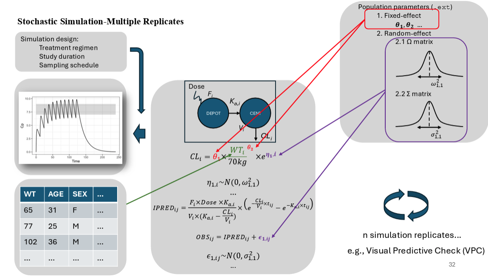

## Simulation with replicates {.smaller}

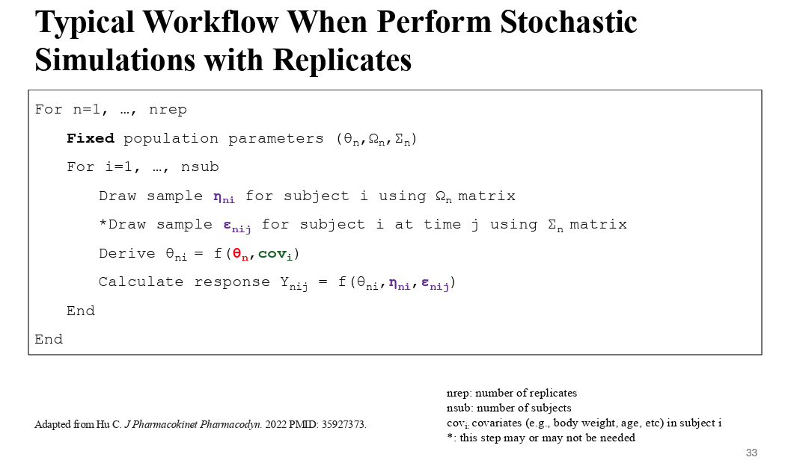

## But then how we should effectively visualize it? {.smaller}

```{r}
#| echo: true
#| warning: false
#| code-fold: true
#| code-summary: "Show the code"
p1 <- sim %>% filter(IREP<10) %>% 
  summ_pk_plot(., .y=Y, show_obs=TRUE)+
  facet_wrap(~IREP)
p1
```

```{r}
#| echo: false
rm(p1) # Remove figure outputs to save RAM
```

## VPC: Observations {.smaller}

-   For observed PK profiles, we will summarize:

    -   10th percentile.

    -   50th percentile.

    -   90th percentile.

## VPC: Simulations {.smaller}

-   For simulated PK profiles, we will summarize:

    -   10th percentile of 10th percentiles across simulation replicates.

    -   50th percentile of 10th percentiles across simulation replicates.

    -   90th percentile of 10th percentiles across simulation replicates.

    -   10th percentile of 50th percentiles across simulation replicates.

    -   50th percentile of 50th percentiles across simulation replicates.

    -   90th percentile of 50th percentiles across simulation replicates.

    -   10th percentile of 90th percentiles across simulation replicates.

    -   50th percentile of 90th percentiles across simulation replicates.

    -   90th percentile of 90th percentiles across simulation replicates.

## An example VPC {.smaller}

```{r}
#| echo: true
#| code-fold: true
#| code-summary: "Show the code"

percentile <- c(0.10, 0.50, 0.90) # Percentiles for visualization
prob       <- c(0.10, 0.50, 0.90) # %PI for percentiles
  
# Summarise observed percentiles
summ_obs <- obs %>% 
  filter(BLQ==0) %>% 
  group_by(NTIME, DOSE) %>% 
  summarise(
    as_tibble_row(
      quantile(DV, percentile,na.rm = TRUE),
      .name_repair= ~ c("lo", "mi", "hi")
      ), .groups = "drop")
  
# Summarise simulated percentiles
summ_sim <- sim %>%  filter(Y>=unique(obs$LLOQ)) %>% 
  group_by(NTIME, DOSE, IREP) %>% 
    summarise(
      as_tibble_row(
        quantile(Y, percentile,na.rm = TRUE),
        .name_repair= ~ c("lo", "mi", "hi")
      ), .groups = "drop") 

# Summarise prediction intervals of simulated percentiles
summ_sim <- summ_sim %>% group_by(NTIME, DOSE) %>% 
  summarise(
    across(c("lo", "mi", "hi"),
           ~ list(setNames(
             quantile(.x, prob, na.rm = TRUE),
             c("lo", "mi", "hi")
             ))), .groups = "drop") %>%
    # widen each list-column (one per Y) into 3 numeric columns
  unnest_wider(c("lo", "mi", "hi"), names_sep = "_")

# head(obs)
# head(sim)

vpc <- ggplot()+
    geom_line(data=summ_obs, aes(x=NTIME, y=lo), linetype=2)+
    geom_line(data=summ_obs, aes(x=NTIME, y=mi), linetype=1)+
    geom_line(data=summ_obs, aes(x=NTIME, y=hi), linetype=2)+
    geom_ribbon(data=summ_sim, aes(x=NTIME, ymin=lo_lo, ymax=lo_hi), alpha=0.25, fill="#ffcc33")+
    geom_ribbon(data=summ_sim, aes(x=NTIME, ymin=mi_lo, ymax=mi_hi), alpha=0.25, fill="#7A0019")+
    geom_ribbon(data=summ_sim, aes(x=NTIME, ymin=hi_lo, ymax=hi_hi), alpha=0.25, fill="#ffcc33")+
    facet_grid(vars(DOSE), labeller=label_both)+
  scale_y_log10()+
  xlab("Time")+
  ylab("Concentrations")+
  ggtitle("Visual Predictive Checks (VPC)")
vpc
```

## An example VPC {.smaller}

We frequently see VPCs with observed concentrations shown as dots, but this is not something required for diagnostic purposes.

```{r}
#| echo: true
#| code-fold: true
#| code-summary: "Show the code"
vpc + geom_point(data=filter(obs, BLQ==0), aes(x=NTIME, y=DV))
```

```{r}
#| echo: false
rm(vpc)
```

## Binning {.smaller}

If you have worked on creating VPCs before, an tedious (or somewhat annoying) issue is binning. Why bothering with it?

-   In reality, we usually develop model using **actual time** instead of **nominal time**.

-   This makes the summarization of the percentiles across time become challenging.

## Binning {.smaller}

```{r}
#| echo: true
#| code-fold: true
#| code-summary: "Show the code"

p1  <- raw_pk_plot(obs, .x=NTIME)+ggtitle("Nominal time")
p2  <- raw_pk_plot(obs, .x=TIME)+ggtitle("Actual time")
p3 <- vpcplot(obs_df=filter(obs, BLQ==0), 
              sim_df=filter(sim, Y>unique(obs$LLOQ)), 
              .x=NTIME, show_obs = TRUE, .xlab = "Time", .ylab = "Concentrations")+
  ggtitle("VPC using nominal time")
p4 <- vpcplot(obs_df=filter(obs, BLQ==0), 
              sim_df=filter(sim, Y>unique(obs$LLOQ)),  
              .x=TIME, show_obs = TRUE, .xlab = "Time", .ylab = "Concentrations")+
  ggtitle("VPC using actual time")
grid.arrange(p1,p2,p3,p4,ncol=2)
```

```{r}
#| echo: false
rm(p1, p2, p3, p4) # Remove figure outputs to save RAM
```

## Binning {.smaller}

-   As we created VPCs using actual time without binning, the plot (bottom right) looks messy, losing diagnostic values.\
-   This is why we want to bin observations based on time intervals when creating VPCs plots.\
-   Essentially, this step classifies actual time into time intervals/bins (i.e., binning), and then summarize observations via grouping by time bins instead of actual times.

## VPC after Binning {.smaller}

```{r}
#| echo: true
#| code-fold: true
#| code-summary: "Show the code"

vpcplot(obs_df=filter(obs, BLQ==0), 
        sim_df=filter(sim, Y>unique(obs$LLOQ)), 
        .x=TIME, show_obs = TRUE, 
        .xlab = "Time", .ylab = "Concentrations", 
        bins = c(119, 120.15, 120.5, 122, 126, 130, 150))

```

## VPC in reality {.smaller}

```{r}
#| echo: true
#| warning: false
#| code-fold: true
#| code-summary: "Show the code"

rep <- 100

withr::with_seed(seed=1314, 
                 sim <- purrr::map(1:rep, function(.irep){
                   mrgsim_df(mod, data_200, obsonly=TRUE, recover="DV,NTIME,DOSE") %>%
                  mutate(IREP=.irep)
                   }) %>% bind_rows()
                 )

```

```{r}
#| echo: true
#| warning: false
library(vpc)

vpc(sim=filter(sim, Y>unique(obs$LLOQ)), 
    obs=filter(obs, BLQ==0),
    obs_cols=list(idv="TIME"), 
    sim_cols=list(idv="TIME", dv="Y"), 
    bins=c(119, 120.15, 120.5, 122, 126, 130, 150), 
    show=list(obs_dv=TRUE), 
    log_y=TRUE, 
    log_y_min=0.1)
```

## VPC in reality {.smaller}

```{r}
#| echo: true
#| warning: false
library(tidyvpc)

obs_data <- as.data.frame(filter(obs, BLQ==0))
sim_data <- as.data.frame(filter(sim, Y>unique(obs$LLOQ))) 

vpc <- observed(obs_data, x=TIME, y=DV) %>%
  simulated(sim_data, xsim=TIME, ysim=Y, repl=IREP) %>%
  binning(bin="breaks", breaks = c(119, 120.15, 120.5, 122, 126, 130, 150))%>%
  vpcstats()
plot(vpc) + scale_y_log10(labels = scales::label_log())

```

## VPC variants {.smaller}

-   Landmark VPCs:

{width="90%"}

-   Prediction-corrected VPCs (pcVPCs): [M. Bergstrand, et al., AAPS J](2011https://www.ncbi.nlm.nih.gov/pubmed/21302010)
-   Reference-corrected VPCs (rcVPCs): [M. Ibrahim, et al., AAPS J 2025](https://www.ncbi.nlm.nih.gov/pubmed/40299161)
